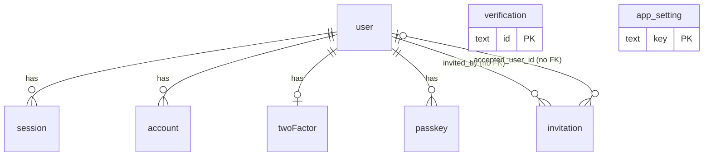

# Project Context: 21-day

A handoff document for developers and AI coding agents working on this repository. Read it fully before changing anything. It explains what the app does, how the code is organized, how to run and test it, and the conventions that keep it working.

The repository holds two separate projects:

| Project | Location | What it is | Ships as |
| --- | --- | --- | --- |
| **The app** | repository root | The self-hosted Next.js tracker (everything in sections 1-7) | Docker image on `ghcr.io/sidhartha426/21-day` (section 8.2) |
| **The landing page** | `docs/landing-page/` | A static Vite + React marketing site for the app | GitHub Pages at **https://21-day.sid426.dev** (section 8.4) |

They share no code and no dependencies; the landing page only reads the README screenshots and copies the scoring formula (section 8.4).

`README.md` is the public, user-facing overview (features, screenshots, setup, configuration) and links to the landing page. The screenshots it embeds live in `docs/screenshots/` and are also used by the landing page. The self-hosting bundle (compose file, env template, Caddyfile, CouchDB config, `init.sh`) lives in `docs/hosting/`. This file is the deeper internal reference; when the two disagree, fix whichever is wrong.

**Current state (last updated 2026-10-16):** every feature in section 1 is implemented and has been tested end to end by the maintainer, including passkeys and SMTP delivery through a real provider (section 7). `pnpm typecheck` is clean, `pnpm build` passes, and the production Docker image builds. Images are published to `ghcr.io/sidhartha426/21-day` by a tag-triggered GitHub Actions workflow (section 8.2). The landing page is live at https://21-day.sid426.dev, deployed by a separate push-triggered workflow (section 8.4). Before deploying, read **section 8**: SQLite on serverless platforms won't persist data, so the supported path is self-hosting with Docker. The landing page is marketing only; it doesn't host an instance of the app.

## 1. What the app does

**21-day** is a self-hostable, multi-user tracker for 21-day practice challenges. A user picks a start date and an ideal number of sessions per day, then logs their actual sessions day by day. At the end, the app scores the run and produces a PDF report.

Requirements the app is built to:

1. Frontend in **Next.js + shadcn/ui (Base UI) + Tailwind**. It is responsive, has light, dark and system themes (dark is the default), and aims to look sleek and modern.
2. **Multi-user auth** with **Better Auth + better-sqlite3**: email or username + password, **optional TOTP 2FA**, and **passkeys**. A passkey sign-in skips 2FA.
3. **SMTP** support (any provider, for example Purelymail) and **ntfy** push notifications.
4. **Admin panel**: manage users, turn off public sign-ups, and invite users by email. There is exactly **one admin account**. Admin access requires a **2FA-verified session**; the only exception is a session that signed in with a passkey.
5. **Apache CouchDB** stores progress data. Development uses a CouchDB container (docker compose).
6. Users can **clear a completed day or re-edit wrongly entered sessions**.
7. When a challenge finishes, the user can either **save it to history** or **download the PDF and discard it**.
8. **History**: each saved challenge can be viewed (read-only), downloaded as a PDF, or deleted, and there is a "delete all history" option.
9. After all 21 days, the UI **congratulates or reprimands** the user based on performance, shows a **score with 0-5 fractional stars**, and **sends the PDF report by ntfy and/or email** if the user configured notifications.
10. Users can **delete their account and all their data**.
11. The backend is Next.js route handlers and server actions on the Node.js runtime.

## 2. Tech stack

This section covers the app only. The landing page has its own, deliberately different stack (Vite, shadcn/ui on **Radix**, the `cn` npm package); see section 8.4 before touching `docs/landing-page/`.

- **Next.js 16.4** (App Router, Turbopack), React 19, TypeScript, **pnpm** (`packageManager: pnpm@12.3.4`)
- **Tailwind CSS v4** (`app/globals.css` holds the light and dark theme tokens), `tw-animate-css`
- **shadcn/ui on Base UI** (`@base-ui/react`). IMPORTANT: these components use the **`render` prop, not `asChild`**. Example: `<DropdownMenuTrigger render={<Button variant="ghost" />}>`, `<Button render={<Link href="/x" />} nativeButton={false}>`.
- `next-themes` (theme switching via `components/theme-provider.tsx` and `components/theme-toggle.tsx`)
- `sonner` toasts, `lucide-react` icons, `swr` for client data, `zod` v4 for validation (`z.email()` etc.)
- **better-auth 1.7.x** plus `@better-auth/passkey`, with the plugins `username`, `twoFactor`, `admin`, and `nextCookies`
- **better-sqlite3** (auth DB). `pnpm-workspace.yaml` has `allowBuilds: better-sqlite3: true`.
- **nodemailer** (SMTP), **pdfkit** (server-side PDF generation), `qrcode.react` (TOTP QR code), `input-otp`
- `next.config.mjs`: pins `process.env.TZ = 'UTC'`, sets `output: 'standalone'` only when `NEXT_OUTPUT=standalone` (the Dockerfile sets it), sets `serverExternalPackages: ['better-sqlite3', 'pdfkit', 'nodemailer']`, and adds baseline security headers. There is **no `typescript.ignoreBuildErrors`** (the build must type-check cleanly) and no `images.unoptimized` (the app uses no `next/image`).
- **Lean dependency policy:** no analytics, speed insights or other telemetry. `shadcn` is a **devDependency** (needed only for the CLI and for the build-time `@import 'shadcn/tailwind.css'` in `globals.css`). Don't add packages or shadcn components that aren't used. `components/ui/label.tsx` and `separator.tsx` look unused but are imported by `field.tsx` and `item.tsx`, so keep them.
- After any `shadcn add`, check that new components import `cn` from `@/lib/utils` (the app has no `cn` npm package; the landing page does, see section 8.4).
- The root `tsconfig.json` excludes `docs/landing-page`, so the app's `pnpm typecheck` and `pnpm build` never see the landing page's code, and vice versa.

### package.json scripts

- `dev`, `build`, `start`
- `typecheck` → `tsc --noEmit`
- `couch:up` → `docker compose -f docker-compose.dev.yml up -d` (dev services only, stock images, no build step; compose project `21-day-dev`):
  - `21-day-dev-couchdb` (`couchdb:3`) on `127.0.0.1:5984`
  - `21-day-dev-mailpit` (`axllent/mailpit`): SMTP on `127.0.0.1:1025`, web inbox on `http://127.0.0.1:8025`. No volume, so messages are in memory and cleared on restart.
- `couch:down` → `docker compose -f docker-compose.dev.yml down` (stops both). The script names predate Mailpit and were kept so existing habits and docs still work.

## 3. Local development

Prerequisites: Node.js 24 (matches the Dockerfile), pnpm, and Docker.

1. `pnpm install --frozen-lockfile`
2. Copy `.env.dev.example` to `.env` (gitignored): `cp .env.dev.example .env`. Set `BETTER_AUTH_SECRET` to a random value, for example `openssl rand -base64 32` or `node -e "console.log(require('crypto').randomBytes(32).toString('base64'))"`. Next.js loads `.env` for `pnpm dev`, and Docker Compose reads the same file for the dev CouchDB credentials, so the `COUCHDB_*` values always match.
3. `pnpm couch:up`, then confirm with `docker ps` that `21-day-dev-couchdb` and `21-day-dev-mailpit` are healthy. `.env.dev.example` already points `SMTP_*` at Mailpit (`127.0.0.1:1025`, `SMTP_SECURE=false`, no user/password), so every email the app sends lands in the inbox at `http://127.0.0.1:8025`. Leave `SMTP_HOST` empty to disable email, or set a real provider to test actual delivery.
4. `pnpm dev`, then open `http://localhost:3000`.
5. **The first account you sign up becomes the admin.** With zero users, `/sign-in` redirects to `/sign-up` on purpose.

Notes:

- Never commit or print `.env*` files (except the `*.example` templates). Restart the dev server after changing env vars.
- `data/` (the SQLite auth DB and the JSON fallback store) and `couchdb/` (the dev CouchDB bind mount) are gitignored and excluded from the Docker build context. To reset everything: stop the dev server, `pnpm couch:down`, then delete `data/` and `couchdb/`. The CouchDB files are owned by uid 5984, so use `sudo rm -r couchdb` (or `docker run --rm -v "$PWD:/w" alpine rm -r /w/couchdb`).
- If `COUCHDB_URL` is unset, progress data falls back to a JSON file at `data/progress.json`. That's handy for quick experiments but isn't meant for real use.

## 4. Environment variables (see `.env.dev.example` and `docs/hosting/.env.docker.example`)

| Var | Purpose |
| --- | --- |
| `BETTER_AUTH_SECRET` | Required. Random secret for signing sessions. |
| `BETTER_AUTH_URL` | Public base URL with no trailing slash. Falls back to the Vercel URL env vars, then `http://localhost:3000`. |
| `PASSKEY_RP_ID` | Optional WebAuthn relying-party ID (defaults to the hostname of the base URL). |
| `DATABASE_PATH` | SQLite file (default `./data/auth.db`). |
| `COUCHDB_URL`, `COUCHDB_USER`, `COUCHDB_PASSWORD`, `COUCHDB_DB` | CouchDB connection. **If `COUCHDB_URL` is unset, the app uses the JSON file store.** The DB name defaults to `challenge_tracker` (CouchDB DB names can't start with a digit). |
| `SMTP_HOST`, `SMTP_PORT`, `SMTP_SECURE`, `SMTP_USER`, `SMTP_PASS` | SMTP. Example for Purelymail: `smtp.purelymail.com`, port 465 secure or 587. When SMTP isn't configured, email features report "unconfigured" and the admin invite UI shows a copyable link instead. |
| `SMTP_FROM` | Sender **address only**, e.g. `noreply@example.com`. Required for mail to count as configured. A legacy `Name <addr>` value still parses. |
| `SMTP_FROM_NAME` | Optional sender display name. Defaults to `APP_NAME` (`21-day`) and overrides any name inside a legacy `SMTP_FROM`. See `getSender()` in `lib/mailer.ts`. |
| `NTFY_DEFAULT_SERVER` | Default ntfy server (`https://ntfy.sh`). |

Docker-only variables (read by `docs/hosting/docker-compose.yml`, not by the app):

| Var | Purpose |
| --- | --- |
| `APP_DOMAIN` | Site address in the Caddyfile; Caddy gets its certificate. |
| `ACME_EMAIL` | Let's Encrypt account email (Caddy global option). |
| `DESEC_API_KEY` | deSEC (DNS hosting provider, not a registrar) API token for the DNS-01 challenge. Only needed when the domain's DNS is hosted at deSEC. |
| `HTTPS_PORT` | Port Caddy listens on and publishes (TCP + UDP). Empty means `443`; the compose file uses `${HTTPS_PORT:-443}` everywhere, because a bare `${HTTPS_PORT}` would produce an invalid `:/tcp` port mapping. |
| `APP_UPSTREAM` | Caddy's `reverse_proxy` target, default `app:3000`. |

In Docker, `DATABASE_PATH` is fixed to `/app/data/auth.db` by the compose file, and `BETTER_AUTH_SECRET`, `BETTER_AUTH_URL`, and `COUCHDB_PASSWORD` use `${VAR:?message}`, so a missing value fails at `docker compose up` with a clear message. The app's port is never published to the host; only Caddy is.

### CouchDB container

- Both compose files use the stock **`couchdb:3`** image (no custom Dockerfile, nothing to build).
- The single-node config is **bind-mounted read-write** into `local.d`: `docker/couchdb/10-single-node.ini` in development and `docs/hosting/couchdb/10-single-node.ini` (`./couchdb/10-single-node.ini` inside the `21-day` folder) in production. It contains only `[couchdb] single_node = true`.
- Why it works now (two rules, **don't change either**):
  - **Keep the `10-` prefix.** `local.d/*.ini` files load in lexical order, and the entrypoint writes the admin credentials to `local.d/docker.ini`. CouchDB persists runtime config writes (such as the hashed admin password) to the *last* file in the chain. `10-single-node.ini` sorts before `docker.ini`, so `docker.ini` stays last and the mounted file is never rewritten.
  - **Don't add `:ro`.** The official entrypoint runs `chown`/`chmod` over `/opt/couchdb`, and a read-only mount makes it crash. As a side effect, the host copy of the ini (and the data directory) end up owned by uid/gid 5984.
- Credentials come from `COUCHDB_USER` / `COUCHDB_PASSWORD` (dev defaults `admin` / `changeme`). Data is a bind mount: `./couchdb/data` (repo root in development, inside the `21-day` folder in production). A healthcheck hits `/_up`.

## 5. Architecture

### 5.1 Data stores and database schema

The app uses two databases with a strict split: **identity lives in SQLite, progress lives in CouchDB**. The only link between them is the Better Auth user id (`user.id` in SQLite), which is embedded in every CouchDB document id. No query ever joins the two; the app reads the session from SQLite, then uses `session.user.id` to address CouchDB documents.

| Store | Module | Holds | Written by |
| --- | --- | --- | --- |
| SQLite (`better-sqlite3`), file at `DATABASE_PATH` (default `./data/auth.db`; in Docker `/app/data/auth.db`, bind-mounted from `21-day/app/data/`) | `lib/db/sqlite.ts` | Accounts, credentials, sessions, 2FA, passkeys, verification tokens, app settings, invitations | Better Auth (its own tables), `lib/app-settings.ts` (custom tables) |
| CouchDB 3 (`COUCHDB_URL`, database `COUCHDB_DB`, default `challenge_tracker`) | `lib/db/couch.ts` | Active challenge, challenge history, per-user notification settings | `lib/challenge-store.ts` only |
| JSON file `data/progress.json` (fallback only, when `COUCHDB_URL` is unset) | `lib/db/couch.ts` (`FileStore`) | Same documents as CouchDB | `lib/challenge-store.ts` only |

#### 5.1.1 SQLite: connection and migrations

- `lib/db/sqlite.ts` opens a single connection (cached on `globalThis` in development so hot reloads don't leak handles), creates the parent directory if needed, and sets `PRAGMA journal_mode = WAL` (so you'll see `auth.db-wal` and `auth.db-shm` next to `auth.db`; back up all three, or run `VACUUM INTO` / the SQLite backup API for a consistent copy) and `PRAGMA foreign_keys = ON` (required for the `ON DELETE CASCADE` rules below).
- The two **custom tables** (`app_setting`, `invitation`) are created with `CREATE TABLE IF NOT EXISTS` every time the connection opens. There is no migration framework for them: to change them, add an idempotent `ALTER TABLE` next to the `CREATE` in `openDatabase()` and keep old rows readable.
- The **Better Auth tables** are created and altered by `lib/migrate.ts` (`getMigrations(auth.options)` from `better-auth/db/migration`), which `instrumentation.ts` runs once on server start. It only adds missing tables and columns; it never drops or renames anything. The table and column set is derived from the plugins and `additionalFields` in `lib/auth.ts`, so **adding a plugin or an additional field changes the schema on the next boot**. Removing one leaves the old columns in place (harmless).
- Column naming: Better Auth tables use quoted camelCase (`"userId"`, `"createdAt"`); custom tables use snake_case. Booleans are `INTEGER` 0/1. Better Auth `date` columns are stored as ISO 8601 text in UTC (e.g. `2026-10-14T13:21:38.581Z`); the custom tables store **Unix epoch milliseconds** as `INTEGER`.
- Ids: Better Auth generates 32-character random alphanumeric ids; invitations use `crypto.randomUUID()`.

#### 5.1.2 SQLite: entity relationships



`session`, `account`, `twoFactor`, and `passkey` reference `user.id` with `ON DELETE CASCADE`. `verification`, `invitation`, and `app_setting` have no foreign keys.

#### 5.1.3 SQLite: Better Auth tables

**`user`** — one row per account (core table plus columns added by the `username`, `twoFactor`, and `admin` plugins and the `theme` additional field).

| Column | Type | Constraints | Notes |
| --- | --- | --- | --- |
| `id` | text | PK | Better Auth id. Also the `{userId}` segment of every CouchDB document id. |
| `name` | text | not null | Display name; editable in Settings → Profile. |
| `email` | text | not null, unique | Stored lowercased. Used for sign-in, invites, and email reports. |
| `emailVerified` | integer | not null | Always `0`: email verification isn't enabled. |
| `image` | text | | Unused. |
| `createdAt`, `updatedAt` | date | not null | ISO text, UTC. |
| `username` | text | unique | `username` plugin. Normalized (lowercase), 3-30 characters. Sign-in accepts email or username. |
| `displayUsername` | text | | `username` plugin. The username as the user typed it. |
| `twoFactorEnabled` | integer | | `twoFactor` plugin. `1` once TOTP setup is verified. |
| `role` | text | | `admin` plugin. `'admin'` for exactly one user (the first sign-up, set in `databaseHooks.user.create.before`), `'user'` for everyone else. The endpoints that could change this are blocked (section 5.3). |
| `banned` | integer | | `admin` plugin. `1` blocks sign-in; banning also revokes all sessions. |
| `banReason` | text | | Optional, max 200 characters (trimmed by `banUserAction`). |
| `banExpires` | date | | Always null: bans from the admin panel are permanent until unbanned. |
| `theme` | text | | Additional field: `'light' \| 'dark' \| 'system'` or null (never chosen). `input: false`, so it can only be written through `PUT /api/settings/theme`. |

**`session`** — one row per signed-in browser. Lifetime is 7 days, refreshed when older than 1 day (`session.expiresIn` / `updateAge`).

| Column | Type | Constraints | Notes |
| --- | --- | --- | --- |
| `id` | text | PK | |
| `token` | text | not null, unique | Value of the signed `better-auth.session_token` cookie. |
| `userId` | text | not null, FK → `user.id` on delete cascade | Indexed (`session_userId_idx`). |
| `expiresAt` | date | not null | |
| `createdAt`, `updatedAt` | date | not null | |
| `ipAddress`, `userAgent` | text | | Recorded by Better Auth. |
| `impersonatedBy` | text | | `admin` plugin. Always null: impersonation is blocked. |
| `authMethod` | text | | Additional field: `'password' \| '2fa' \| 'passkey'`, set in `databaseHooks.session.create.before`. Admin access requires `2fa` or `passkey`. Intentionally has no default (see 5.3). |

**`account`** — credentials. With email + password only, each user has exactly one row with `providerId = 'credential'`.

| Column | Type | Constraints | Notes |
| --- | --- | --- | --- |
| `id` | text | PK | |
| `userId` | text | not null, FK → `user.id` on delete cascade | Indexed (`account_userId_idx`). |
| `accountId` | text | not null | Equals `userId` for the credential provider. |
| `providerId` | text | not null | `'credential'`. |
| `password` | text | | scrypt hash in `salt:hash` hex form (Better Auth default). Never selected by app code. |
| `accessToken`, `refreshToken`, `idToken`, `accessTokenExpiresAt`, `refreshTokenExpiresAt`, `scope` | text / date | | OAuth columns; unused (no social providers). |
| `createdAt`, `updatedAt` | date | not null | |

**`twoFactor`** — TOTP state (`twoFactor` plugin), at most one row per user.

| Column | Type | Constraints | Notes |
| --- | --- | --- | --- |
| `id` | text | PK | |
| `userId` | text | not null, FK → `user.id` on delete cascade | Indexed. |
| `secret` | text | not null | TOTP secret, **encrypted with `BETTER_AUTH_SECRET`**. Indexed (`twoFactor_secret_idx`). |
| `backupCodes` | text | not null | JSON array of 10 one-time codes, **encrypted with `BETTER_AUTH_SECRET`** (`storeBackupCodes: 'encrypted'`, the plugin default). |
| `verified` | integer | | `1` after the first successful code during setup. |
| `failedVerificationCount`, `lockedUntil` | integer / date | | Brute-force lockout bookkeeping maintained by the plugin. |

**`passkey`** — WebAuthn credentials (`@better-auth/passkey`), any number per user.

| Column | Type | Constraints | Notes |
| --- | --- | --- | --- |
| `id` | text | PK | |
| `userId` | text | not null, FK → `user.id` on delete cascade | Indexed. |
| `name` | text | | Optional label from Settings → Security. |
| `publicKey` | text | not null | COSE public key (base64). |
| `credentialID` | text | not null | Authenticator credential id. Indexed. |
| `counter` | integer | not null | Signature counter. |
| `deviceType` | text | not null | `singleDevice` or `multiDevice`. |
| `backedUp` | integer | not null | Whether the credential is synced (e.g. iCloud Keychain). |
| `transports` | text | | Comma-separated transports (`internal`, `usb`, ...). |
| `aaguid` | text | | Authenticator model id. |
| `createdAt` | date | | |

Passkeys are bound to the relying-party id (`PASSKEY_RP_ID`, default: the hostname of `BETTER_AUTH_URL`). Changing the domain makes existing passkeys unusable.

**`verification`** — short-lived tokens owned by Better Auth (password-reset links valid for 1 hour, pending two-factor sign-ins, passkey challenges). Columns: `id` (PK), `identifier` (indexed; encodes the purpose and the token), `value`, `expiresAt`, `createdAt`, `updatedAt`. Rows are disposable; deleting them only cancels in-flight flows.

#### 5.1.4 SQLite: custom tables

**`app_setting`** — global key/value settings (`lib/app-settings.ts`).

| Column | Type | Constraints | Notes |
| --- | --- | --- | --- |
| `key` | TEXT | PK | |
| `value` | TEXT | not null | Always a string. |

Known keys: `signups_enabled` (`'true' \| 'false'`). **A missing row means sign-ups are open**: `getSignupsEnabled()` returns `value !== 'false'`. Writes are upserts (`INSERT ... ON CONFLICT(key) DO UPDATE`).

**`invitation`** — admin-issued sign-up links (`lib/app-settings.ts`).

| Column | Type | Constraints | Notes |
| --- | --- | --- | --- |
| `id` | TEXT | PK | `randomUUID()`. |
| `email` | TEXT | not null | Trimmed and lowercased. The invited sign-up must use this exact address. |
| `token_hash` | TEXT | not null, unique | SHA-256 hex of the raw token. The raw token (32 random bytes, base64url) exists only in the link `/sign-up?invite=TOKEN` and is never stored. |
| `invited_by` | TEXT | | Admin `user.id` (not a foreign key). |
| `created_at` | INTEGER | not null | Epoch ms. |
| `expires_at` | INTEGER | not null | `created_at` + 7 days. |
| `accepted_at` | INTEGER | | Epoch ms; null while pending. |
| `accepted_user_id` | TEXT | | `user.id` of the account created from the invite (not a foreign key; can dangle if that user is later deleted). |

Rules: creating an invite first deletes any **pending** invite for the same email, so there's at most one pending invite per address. An invite is valid when `token_hash` matches, `accepted_at IS NULL`, and `expires_at > now`. It's consumed in `databaseHooks.user.create.after` (`markInvitationAccepted`). Accepted and expired rows are kept as an audit trail; `listInvitations()` returns the newest 100. Revoking deletes the row.

#### 5.1.5 CouchDB: database and access pattern

- One database (`COUCHDB_DB`, default `challenge_tracker`; CouchDB names can't start with a digit, which is why it isn't `21-day`). `CouchStore` creates it on first use with `PUT /{db}` (a `412` means it already exists). Authentication is HTTP Basic with `COUCHDB_USER` / `COUCHDB_PASSWORD`, or credentials embedded in `COUCHDB_URL`.
- The container is single-node (`10-single-node.ini` sets `[couchdb] single_node = true`, which also creates the `_users` and `_replicator` system databases).
- **No design documents, views, or Mango indexes.** Every read is either a primary-key `GET /{db}/{id}` or a range scan on the built-in `_all_docs` index: `startkey = "<prefix>"`, `endkey = "<prefix>\ufff0"`, `include_docs=true`. That's why document ids are hierarchical, prefix-friendly strings.
- Bulk delete (`removeByPrefix`) lists the prefix, then posts `_deleted: true` stubs to `_bulk_docs`. CouchDB keeps tombstones; run compaction (`POST /{db}/_compact`) if disk usage matters.
- Every document carries a `type` discriminator (`'active' | 'history' | 'settings'`) and a redundant `userId`, so documents are self-describing in Fauxton or exports. Neither field is used for lookups.

#### 5.1.6 CouchDB: document id scheme

All per-user data shares one prefix, so purging a user is a single prefix delete.

| Id pattern | Type | Cardinality |
| --- | --- | --- |
| `user:{userId}:active` | `ActiveChallenge` | 0 or 1 per user |
| `user:{userId}:settings` | `NotificationSettings` | 0 or 1 per user (created on first save; defaults are synthesized in memory until then) |
| `user:{userId}:history:{historyId}` | `HistoryEntry` | 0..n per user |

`historyId` = `Date.now().toString(36).padStart(9, '0')` + `-` + 3 random bytes in hex (e.g. `0mv854vun-405736`). The zero-padded base36 timestamp makes lexical order equal chronological order (by archive time), so `listByPrefix` returns oldest first and `listHistory()` reverses it to newest first. Route handlers validate ids against `/^[a-z0-9-]+$/` before building a document id.

#### 5.1.7 CouchDB: document shapes

Shared value types (`lib/challenge.ts`):

- `ChallengeConfig`: `{ startDate: 'YYYY-MM-DD' (UTC calendar date, validated by isValidIsoDate), idealPerDay: integer 1-1000 }`
- `DayRow`: `{ day: 1-21, date: 'YYYY-MM-DD', sessionsCompleted: integer 0-10000 (MAX_SESSIONS_PER_DAY), dayCompleted: boolean }`. A cleared or pending day is `{ sessionsCompleted: 0, dayCompleted: false }`; `0` with `dayCompleted: true` is a legitimately logged zero day.

**`ActiveChallenge`** (`user:{userId}:active`) — the challenge in progress. Created by `startChallenge` (409 if one already exists), removed by abandon, discard, or archive.

| Field | Type | Notes |
| --- | --- | --- |
| `_id`, `_rev` | string | CouchDB metadata. `_rev` grows with every logged, edited, or cleared day. |
| `type` | `'active'` | |
| `userId` | string | |
| `config` | `ChallengeConfig` | Immutable after start. |
| `rows` | `DayRow[21]` | Pre-built by `buildRows(startDate)` with consecutive UTC dates. |
| `createdAt`, `updatedAt` | ISO datetime | `updatedAt` changes on every day update. |
| `completionNotifiedAt` | ISO datetime or null | Set (via `store.update`) after the completion report is sent; reset to null whenever the challenge becomes incomplete again so a re-completion notifies again. |

```json
{
  "_id": "user:Yg0YSVcQHwy2dws1QSjASRCAfSSDY2DN:active",
  "_rev": "61-5433aaac1deed91197dc617d5d8a8c97",
  "type": "active",
  "userId": "Yg0YSVcQHwy2dws1QSjASRCAfSSDY2DN",
  "config": { "startDate": "2026-09-30", "idealPerDay": 8 },
  "rows": [
    { "day": 1, "date": "2026-09-30", "sessionsCompleted": 8, "dayCompleted": true },
    { "day": 15, "date": "2026-10-14", "sessionsCompleted": 0, "dayCompleted": false }
  ],
  "createdAt": "2026-10-14T13:23:38.020Z",
  "updatedAt": "2026-10-14T13:23:39.136Z",
  "completionNotifiedAt": null
}
```

(`rows` is shortened here; real documents always contain all 21 rows.)

**`HistoryEntry`** (`user:{userId}:history:{historyId}`) — an immutable snapshot written by `archiveActiveChallenge` (only for a complete challenge), which then deletes the active document. History is never edited, only deleted.

| Field | Type | Notes |
| --- | --- | --- |
| `type` | `'history'` | |
| `userId`, `historyId` | string | `historyId` duplicates the id suffix. |
| `config`, `rows` | as above | Copied verbatim from the active challenge. |
| `scorePct` | number | Unrounded `totalSessions / (idealPerDay * 21) * 100`; may exceed 100. |
| `stars` | number | Fractional stars at archive time. **Display code never reads it**; it always recomputes from `scorePct` with `starsForScore()`. Docs written before fractional stars store an integer here. |
| `totalSessions` | integer | |
| `createdAt` | ISO datetime | When the challenge was started (copied from the active doc). |
| `completedAt` | ISO datetime | When it was saved to history. |

**`NotificationSettings`** (`user:{userId}:settings`)

| Field | Type | Notes |
| --- | --- | --- |
| `type` | `'settings'` | |
| `userId` | string | |
| `emailEnabled` | boolean | Default `false`. Sends to the account email; only works when SMTP is configured. |
| `ntfyEnabled` | boolean | Default `false`. Requires a non-empty `ntfyTopic`. |
| `ntfyServer` | string | Default `NTFY_DEFAULT_SERVER` (`https://ntfy.sh`); normalized by `normalizeNtfyServer`, max 300 characters. |
| `ntfyTopic` | string | `''` or `/^[A-Za-z0-9_-]{1,64}$/`. |
| `ntfyToken` | string | Optional ntfy access token, max 500 characters. **Stored in plain text**; API responses expose only `hasNtfyToken`. In a PUT, omitting the field keeps it, `null` removes it, and a string replaces it. |

#### 5.1.8 Concurrency, consistency, and the file fallback

- `DocStore` interface: `get`, `put`, `update`, `remove`, `listByPrefix`, `removeByPrefix`. Network failures throw `StoreUnavailableError`, which `lib/api.ts` maps to HTTP 503.
- `put()` retries 409 conflicts against the latest `_rev` (last write wins per document), but **throws instead of recreating a doc that was deleted concurrently**. `update(id, mutate)` is an atomic read-modify-write with 409 retry; it returns `null` and **never recreates** a missing doc. `remove()` retries on 409. The completion notifier (`markCompletionNotified`, which runs in `after()`) uses `update()` so it can't race with save/discard and resurrect the active challenge.
- Archiving is two writes (put history, then delete active). If the process dies between them, the user keeps both the saved history entry and the active completed challenge; nothing is lost, and saving again creates a second history entry.
- `FileStore` (no `COUCHDB_URL`) keeps every document in memory and rewrites `data/progress.json` (a JSON array of documents) synchronously on each write. Revisions look like `3-local`. It has no conflict detection, isn't safe across multiple processes, and is meant only for quick local experiments. `storeBackend` (`'couchdb' | 'file'`) reports which store is active.

#### 5.1.9 Data lifecycle

| Event | SQLite | CouchDB |
| --- | --- | --- |
| Sign-up | `user` + `account` (+ `session` with auto sign-in); invite marked accepted | nothing |
| Start challenge | | create `user:{id}:active` |
| Log / edit / clear a day | | update `active` |
| Challenge completes | | `active.completionNotifiedAt` set after the report is sent |
| Save to history | | create `history:{historyId}`, delete `active` |
| Download PDF and discard / abandon | | delete `active` |
| Delete one / all history | | delete `history:{historyId}` / prefix `user:{id}:history:` |
| Save notification settings | | upsert `user:{id}:settings` |
| Ban / unban | `user.banned`, `banReason`; sessions deleted on ban | nothing |
| Delete account (self or admin) | `user` row deleted; `session`, `account`, `twoFactor`, `passkey` cascade | `purgeUserData` deletes prefix `user:{id}:` (in `databaseHooks.user.delete.after` and again in `removeUserAction`). A CouchDB failure here is logged, not fatal, so orphaned documents are possible if CouchDB was down. |

Other helpers: `countUsers()` and `countAdmins()` (both return 0 before the `user` table exists). The raw `sqlite` handle is exported; admin actions use it for role and email lookups.

#### 5.1.10 Backups, resets, and secrets

- There are **no named volumes**; everything is a bind mount inside the self-hosted `21-day` folder (`app/data`, `couchdb/data`, `caddy/data`, `caddy/config`, plus `.env` and the config files). The supported backup is: `docker compose down`, then `sudo tar -czpf 21-day-backup.tar.gz -C .. 21-day`, then `docker compose up -d`. Stopping first gives a consistent SQLite (WAL) and CouchDB snapshot; `sudo` + `-p` preserves the owners the containers need (uid 1000 for `app/data`, 5984 for CouchDB). Restore by extracting with `sudo tar -xzpf` and running `docker compose up -d`. A backup/restore round trip was verified: sessions and active challenges survive.
- Always back up SQLite and CouchDB together. Restoring only one leaves users without progress, or progress documents for users that no longer exist (harmless but orphaned).
- **Keep `BETTER_AUTH_SECRET` stable.** It signs session cookies and encrypts `twoFactor.secret` and `twoFactor.backupCodes`. Rotating it signs everyone out and breaks 2FA for every user who enabled it (they'd need it reset in the database). It lives in `.env`, which is part of the folder backup.
- Full local reset: see section 3 (delete `data/` and `couchdb/` after `pnpm couch:down`).
- Inspect data: `sqlite3 data/auth.db '.schema'`, or CouchDB's Fauxton UI at `http://127.0.0.1:5984/_utils` in development (the production compose file doesn't publish CouchDB).

### 5.2 Domain logic

- `lib/challenge.ts` (pure, shared by client and server): `CHALLENGE_DAYS=21`, `buildRows`, `computeRows` (cumulative total and % of ideal-to-date, counting completed days only), `summarize` (completedDays, totalSessions, idealTotal, scorePct, stars, isComplete, nextDayIndex), `MAX_STARS=5`, `starsForScore` (**fractional**: `min(scorePct, 100) / 20`, rounded to 2 decimals, so 72.86% → 3.64 stars and 10% → 0.5), `formatStars(stars)` → `"3.64/5"`, `verdictFor(stars)` (thresholds on the fractional value: ≥5 "Flawless", ≥4 celebrate, ≥3 encourage, ≥2 / ≥1 / else reprimand; the message starts with `You earned 3.64/5 stars.`), and `formatDay`.
- `lib/dates.ts` (client-safe): UTC-only formatters `formatUtcDate`, `formatUtcDateTime`, `formatUtcWeekdayDay`, `formatUtcDayMonth`, and `todayUtcIso`. Use these for every rendered date.
- `lib/app-config.ts` (client-safe): `APP_NAME = '21-day'`, `APP_DESCRIPTION`.
- `lib/theme.ts` (client-safe): `DEFAULT_THEME = 'dark'`, `THEME_PREFERENCES`, `themePreferenceSchema`, `isThemePreference`.
- `lib/challenge-store.ts` (server): `getActiveChallenge`, `startChallenge`, `updateDay`, `markCompletionNotified`, `discardActiveChallenge`, `archiveActiveChallenge` (requires a complete challenge and moves it to history), `listHistory` (newest first), `getHistoryEntry`, `deleteHistoryEntry`, `deleteAllHistory`, `purgeUserData`, `getNotificationSettings`, `saveNotificationSettings`, and `ChallengeError(message, status)`.
  - `updateDay` accepts `{action: 'set', day, sessions}` for the next pending day OR an already-completed day (that's how re-editing works), and `{action: 'clear', day}` to un-complete a day. It returns `justCompleted`.
- `lib/notification-settings.ts` (client-safe): the `PublicNotificationSettings` type, `toPublicNotificationSettings()` (masks `ntfyToken` and exposes `hasNtfyToken`), and `notificationSettingsSchema` (zod, used by the PUT route).
- `lib/pdf.ts`: `renderChallengePdf({config, rows, ownerName, completedAt})` returns a Buffer (pdfkit). Stars are drawn fractionally: an empty star, then the gold star clipped with `doc.rect(...).clip()` inside `save()`/`restore()`. `lib/report-filename.ts`: `reportFilenameFor(config)` → `21-day-YYYY-MM-DD.pdf` (client-safe).
- `lib/mailer.ts`: `isMailConfigured()` (needs `SMTP_HOST` + `SMTP_FROM`), `sendMail({to, subject, text, html, attachments?})`, and `renderEmail({heading, body, action?})` (HTML template).
- `lib/notify.ts`: `sendChallengeReport(user, challenge)` sends the PDF by email and/or ntfy based on the user's settings and returns `{email, ntfy}`, each `'sent' | 'disabled' | 'failed' | 'unconfigured'`. Headline format: `3.64/5 stars - 72.9% of your ideal target`. Also exports `sendTestNotification(user, channel, settings)`, `normalizeNtfyServer`, and `NTFY_TOPIC_PATTERN`.
- `lib/app-settings.ts`: `getSignupsEnabled`, `setSignupsEnabled`, `createInvitation(email, invitedBy)` (returns the raw token for the link `/sign-up?invite=TOKEN`), `findValidInvitation`, `markInvitationAccepted`, `listInvitations`, and `deleteInvitation`.

### 5.3 Auth (`lib/auth.ts`, `lib/auth-client.ts`, `lib/session.ts`)

- Email + password (min 8 characters), username plugin (3-30 characters), twoFactor (TOTP), passkey, admin plugin, and nextCookies. `baseURL` is exported from `lib/auth.ts`.
- In development only, cookies use `sameSite: 'none', secure: true` so sign-in also works inside cross-site preview iframes, and the trusted origins include `http://localhost:3000` plus a few optional preview-host URL env vars that are ignored when unset. In production, trusted origins come from `BETTER_AUTH_URL` and the Vercel URL vars.
- **The first registered user becomes the single admin** (`databaseHooks.user.create.before`). Everyone after that gets the `user` role.
- **Sign-up gate** (`hooks.before` on `/sign-up/email`): the first user is always allowed. Otherwise the request needs either a valid invite (header `x-invite-token`, and the email must match) or `signups_enabled !== 'false'`. The sign-up page shows "Sign-ups are closed" and "Invitation not valid" states.
- **Session field `authMethod`** (`'password' | '2fa' | 'passkey'`) is set in `databaseHooks.session.create.before` from the request path. Don't give it a default value; defaults would wipe it when 2FA is enabled or disabled (see the code comment).
- **User field `theme`** (`'light' | 'dark' | 'system'`, `input: false`) stores the account's theme. It is written only through `PUT /api/settings/theme`.
- **Admin hardening**: Better Auth's `/admin/*` endpoints require `authMethod` of `2fa` or `passkey`. The paths `set-role`, `create-user`, `update-user`, `impersonate-user`, and `set-user-password` are blocked so there can only ever be one admin. Deleting the admin is blocked. Deleting any user also runs `purgeUserData`.
- `lib/session.ts`: `getSession`, `requireSession` (redirects to `/sign-in`), `getAuthMethod`, `hasStrongAuth`, `isAdmin`, `assertStrongAdmin()` (for server actions; throws), and `getApiSession()` (returns `{session, unauthorized}` for route handlers). The `Session` type is exported from `lib/auth.ts`.
- Client: `authClient` with usernameClient, twoFactorClient (`onTwoFactorRedirect` sends the browser to `/two-factor`), passkeyClient, adminClient, and inferAdditionalFields.

### 5.4 API routes (all use `getApiSession`, zod validation, and `apiError`)

- `app/api/auth/[...all]/route.ts`: the Better Auth handler
- `GET/POST/DELETE /api/challenge`: get the active challenge, start one (`{startDate, idealPerDay}`), or abandon it
- `PATCH /api/challenge/days/[day]` `{sessions}` sets or re-edits a day, and `DELETE` clears it. When the challenge becomes complete, the report is sent in `after()` and the challenge is marked as notified.
- `POST /api/challenge/finish` `{mode: 'save' | 'discard'}`: archive to history or discard (complete challenges only)
- `GET /api/challenge/report`: PDF of the active challenge. `POST` resends the report through the configured channels.
- `GET/DELETE /api/history`: list all entries, or delete all
- `GET/DELETE /api/history/[id]`, and `GET /api/history/[id]/report` (PDF)
- `GET/PUT /api/settings/notifications`: `GET` returns masked settings plus whether mail is configured. `PUT` validates with `notificationSettingsSchema`, normalizes the ntfy server, keeps the existing token if none is sent, and saves.
- `POST /api/settings/notifications/test` `{channel: 'email' | 'ntfy'}`: calls `sendTestNotification`
- `PUT /api/settings/theme` `{theme}`: validates with `themePreferenceSchema` and saves it on the user through `(await auth.$context).internalAdapter.updateUser`

### 5.5 Admin server actions (`app/(admin)/admin/actions.ts`, `'use server'`)

Every action calls `assertStrongAdmin()` first and returns an `ActionResult` (`{ok: true, ...}` or `{ok: false, error}`).

- `setSignupsEnabledAction(bool)`
- `inviteUserAction(email)` returns `{link, emailed}`. It rejects existing emails and sends the email only when SMTP is configured.
- `revokeInvitationAction(id)`
- `banUserAction(userId, reason)`, `unbanUserAction`, `revokeSessionsAction`, and `removeUserAction` (calls `auth.api.removeUser`, then `purgeUserData`)
- `assertManageableUser` refuses to target yourself or the admin.

### 5.6 UI

- `app/layout.tsx`: fonts, `ThemeProvider` (`defaultTheme={DEFAULT_THEME}`, system theme enabled), Toaster, and metadata. `app/page.tsx` redirects to `/dashboard` or `/sign-in`.
- `app/not-found.tsx`: the full-screen branded 404 ("Day 404 isn't on the calendar") with a 21-tile streak grid, a "Back to dashboard" link, and `components/go-back-button.tsx`. It renders without the app header.
- `app/(auth)/`: `layout.tsx` plus the pages `sign-in`, `sign-up` (reads `?invite=` and pre-fills a read-only email), `forgot-password`, `reset-password`, and `two-factor`. Their forms are in `components/auth/*`. The theme toggle here only changes the local browser's theme.
- **App shell** `components/app-shell.tsx` (`<AppShell session>`): renders `AccountThemeSync`, `AppHeader` (desktop and mobile nav linking to Dashboard, History, Settings, and Admin for the admin; a persisting theme toggle; an account menu with sign out), and a "Secure your admin session" alert when the admin lacks strong auth (links to `/settings?tab=security`).
  - `app/(app)/layout.tsx` calls `requireSession` and renders `AppShell` for the dashboard, history, and settings.
  - `app/(admin)/layout.tsx` calls `requireSession`, then `notFound()` for non-admins **before** rendering `AppShell`. That's why non-admins visiting `/admin` see only the standalone 404, with no header.
- **Theme persistence**: `<ThemeToggle persist />` (header only) calls `setTheme` and then `PUT /api/settings/theme`. `components/account-theme-sync.tsx` applies the saved `session.user.theme` once per signed-in app mount, so the choice follows the account across sign-ins and devices.
- **Dashboard** `app/(app)/dashboard/page.tsx` → `components/dashboard/challenge-view.tsx` (SWR on `/api/challenge` with `fallbackData` from the server component). Components:
  - `start-challenge-form.tsx`
  - `progress-overview.tsx` (stat cards plus `StreakGrid`)
  - `day-table.tsx`: log the next day, edit or clear completed days; future days are locked; Enter submits (IME-safe). Each `SessionsInput` focuses and selects its input on mount. Inputs are keyed by day and mount when a day becomes the next pending one (on load and after logging the previous day) or when editing starts, so after Enter saves a day the next day's input is focused automatically.
  - `completion-panel.tsx`: verdict, stars, score, the channels the report went to, resend report, save to history, or download the PDF and discard.
- **History** `app/(app)/history/page.tsx` → `components/history/history-list.tsx` (SWR on `/api/history`, cards, delete all, empty state). `history-entry-actions.tsx` handles view, download, and delete per card. `app/(app)/history/[id]/page.tsx` is a read-only table with `history-entry-detail-actions.tsx` (download and delete). A missing entry renders `app/(app)/history/[id]/not-found.tsx`, an in-shell "Challenge not found" card.
- **Settings** `app/(app)/settings/page.tsx` (the server component loads the user, passkeys via `auth.api.listPasskeys`, the auth method, notification settings, and mail config) → `components/settings/settings-tabs.tsx` (`?tab=profile|security|notifications|danger`):
  - `profile-section.tsx`: name and username via `authClient.updateUser`, and change password
  - `security-section.tsx`: enable 2FA (QR code and backup codes), verify, disable, and regenerate backup codes; add, list, and delete passkeys; shows the current auth method
  - `notifications-section.tsx`: email and ntfy toggles, server, topic, token, and send-test buttons
  - `danger-zone.tsx`: `authClient.deleteUser({password})`, confirmed by typing **"delete my account"**. Disabled for the admin.
- **Admin** `app/(admin)/admin/page.tsx`: shows a blocking "secure your session" state when `!hasStrongAuth`. Otherwise it renders `components/admin/signups-card.tsx`, `invitations-card.tsx` (invite form, copyable link, pending list with revoke), and `users-table.tsx` (search, ban/unban with reason, revoke sessions, remove; no actions on the admin row).
- Shared components:
  - `components/brand.tsx` (renders "21-day")
  - `components/star-rating.tsx`: `<StarRating scorePct size="sm|md|lg" />`, fractional fill, aria-label like "3.64 out of 5 stars"
  - `components/confirm-button.tsx`: an AlertDialog-wrapped Button with `title`, `description`, `confirmLabel`, and `onConfirm`
  - `components/number-input.tsx`: `<NumberInput value onValueChange className inputClassName ref />`. It hides the browser's native spin buttons and draws its own chevrons, which call the native `stepUp`/`stepDown` (so `min`/`max`/`step` still apply) and keep focus in the input. It looks the same in every browser. Use it for any numeric field.
  - the shadcn components in `components/ui/*`
- Client fetch helpers in `lib/fetcher.ts`: `fetchJson<T>(url, init)` (sets the JSON content type and throws `Error(body.error)`), `fetcher` for SWR, and `downloadFile(url, filename)`.

## 6. Conventions and gotchas

- **UTC everywhere**: never use `Intl.DateTimeFormat`, `toLocale*`, or local-time `Date` getters for anything rendered or stored. Use `lib/dates.ts` (hand-rolled formatters, so Node and browsers render identical strings and hydration matches). Store ISO strings (`toISOString()`) and `YYYY-MM-DD` dates. Compute "today" on the server (`todayUtcIso()`) and pass it down. `TZ=UTC` is pinned in `next.config.mjs`, `instrumentation.ts`, the Dockerfile, and both compose files (`TZ: Etc/UTC` in `docs/hosting/docker-compose.yml`).
- Use `APP_NAME` from `lib/app-config.ts` instead of hardcoding the app name.
- Stars: always derive them from `scorePct` via `starsForScore()` or `<StarRating scorePct />`; never round to integers. Old history docs may still store an integer `stars` field; nothing reads it.
- Server-only modules (`lib/auth.ts`, `lib/challenge-store.ts`, `lib/db/*`, `lib/pdf.ts`, `lib/mailer.ts`, `lib/notify.ts`, `lib/app-settings.ts`) must never be imported into client components. Client components may import `lib/challenge.ts`, `lib/dates.ts`, `lib/theme.ts`, `lib/app-config.ts`, `lib/report-filename.ts`, `lib/fetcher.ts`, `lib/notification-settings.ts`, and `lib/auth-client.ts`, and may use `import type` from server modules.
- **Scoring is duplicated on the landing page.** `docs/landing-page/src/lib/scoring.ts` copies the score formula, the star formula, and the verdict titles and messages from `lib/challenge.ts` so the interactive demo matches the real app. If you change `CHALLENGE_DAYS`, `starsForScore`, `baseVerdict`, or the verdict thresholds, make the same change there (section 8.4 maps the names).
- Next.js 16: `params`, `searchParams`, `headers()`, and `cookies()` are async and must be awaited. Read the guides in `node_modules/next/dist/docs/` before using unfamiliar Next.js APIs (see `AGENTS.md`).
- Pass initial data from server components and use SWR on the client. Don't fetch inside `useEffect`.
- Admin mutations go through the server actions in `app/(admin)/admin/actions.ts`. Always call `assertStrongAdmin()` first.
- Any page that should 404 **without** the app header must call `notFound()` from a layout that sits above `AppShell`, not from a page inside it.
- For read-modify-write on an existing document that can race with background work, use `store.update(id, mutate)` instead of `get` + `put`.
- A Base UI `Button` with `render={<Link />}` MUST also pass `nativeButton={false}`. Those elements have the accessibility role **button** (with an href), so browser tests should look for buttons, not links.
- `components/theme-provider.tsx` sets `scriptProps={{ type: 'application/json' }}` on the client only, so React 19 doesn't warn about script tags during client renders. Keep it.
- Toasts use `toast: "cn-toast font-sans"` in `components/ui/sonner.tsx`; without it they render in the mono font.
- Settings tabs use `no-scrollbar overflow-x-auto overflow-y-hidden` (`@utility no-scrollbar` lives in `globals.css`) to avoid a stray 1px scrollbar.
- pdfkit, nodemailer, and better-sqlite3 must stay in `serverExternalPackages`.
- In JSX, escape apostrophes (`&apos;` or `{"..."}`).
- Mobile-first, semantic HTML, `sr-only` labels, `aria-hidden` on decorative icons, and the design tokens from `globals.css` (`bg-background`, `text-muted-foreground`, `bg-primary`, and so on).
- **Don't lower `CHALLENGE_DAYS`** to speed up testing; fast-forward through the API instead (section 9).
- Harmless logs: on a fresh DB, Better Auth prints "Database schema mismatch / Missing tables" about 100ms before `[auth] Migrated SQLite schema` (the instrumentation migration races Better Auth's own check). `docker build` prints `BetterAuthError: You are using the default secret` during page-data collection because no secret exists at build time.

## 7. Verification status

**Every feature in section 1 has been tested by the maintainer**, including passkeys (real WebAuthn authenticator), SMTP delivery through a real provider, invite emails, forgot/reset password, profile name/username update, change password, disabling 2FA, and regenerating backup codes. There are no known unverified features.

Flows verified end to end in a real browser during development:

- First-run flow: with zero users, `/sign-in` redirects to `/sign-up`, and the first sign-up becomes the admin.
- Dashboard: start a challenge, log days with Enter (focus moves to the next day), edit a completed day (its value is pre-selected), clear a day through the confirm dialog, and see percentages and cumulative totals update. The custom number stepper works in Chromium.
- Completion: a 90% run showed 4 stars and a celebrating verdict; an all-2s run showed the reprimand; a 153/210 run (72.9%) showed 3.64 stars in the UI and in the PDF. The report arrived via ntfy **with the PDF attached**. Save to history and "Download PDF and discard" both work.
- History: list, read-only detail view, PDF download (valid PDF, correct content-disposition), single delete, delete all, and the "Challenge not found" state.
- Security: enable TOTP 2FA (QR code, manual key, backup codes), then sign in with username + password + TOTP through `/two-factor`.
- Admin: the blocking state with a password-only session (both the UI and `/api/auth/admin/*` reject it); the panel unlocks after 2FA. Verified the sign-up toggle, invite link creation, signing up through an invite while sign-ups are closed, ban (kills sessions and blocks sign-in), unban, sign out everywhere, and remove user (purges both the SQLite user and the `user:{id}:*` docs). Non-admins see no Admin nav, and `/admin` shows the standalone 404 without the header.
- Danger zone: self-delete purges both the SQLite user and the documents.
- Notifications: saving settings and the ntfy "Send test" button. `SMTP_FROM_NAME` was verified against a local Mailpit container.
- Theme: dark by default; a chosen theme is saved on the account and applied when signing in from a fresh browser.
- Layout: dark and light themes and a 375px viewport on the dashboard, day table, admin page, and 404 page, with no page-level horizontal overflow (the day table scrolls inside its card).
- Production: the full self-hosting stack (sign-up, challenge flow, PDF report, data persisting across `down`/`up`, container TZ is UTC).
- Self-hosting bundle: `init.sh` against a local clone, then `docker compose up -d couchdb app` from the generated folder (both healthy, bind mounts owned correctly), followed by a `tar` backup and restore into a new directory with sessions and challenge data intact.
- Landing page: `pnpm install --frozen-lockfile`, `pnpm lint`, and `pnpm build` pass in `docs/landing-page/`, and the deployed site at https://21-day.sid426.dev responds over HTTPS.

## 8. Deployment

### 8.1 Self-hosting with Docker (supported)

Everything a self-hoster needs is in `docs/hosting/`:

| File | Purpose |
| --- | --- |
| `docker-compose.yml` | The production stack (compose project `21-day`, network `21_day_network`, shared `json-file` log rotation of 3 × 10 MB). |
| `.env.docker.example` | Env template; becomes `.env`. |
| `caddy/Caddyfile` | Caddy config: deSEC DNS-01 TLS, strict security headers, `zstd br gzip`, `reverse_proxy {$APP_UPSTREAM}`. `auto_https disable_redirects` because port 80 isn't used. |
| `couchdb/10-single-node.ini` | CouchDB single-node config (section 4, "CouchDB container"). |
| `init.sh` | One-time setup script (below). |

Services (all prebuilt images, **no `docker build` on the server**):

- `couchdb`: `couchdb:3`, internal only (no published port), healthcheck on `/_up`, data in `./couchdb/data`.
- `app`: `ghcr.io/sidhartha426/21-day:latest`, the multi-stage root `Dockerfile` (Next.js standalone on `node:24-trixie-slim`, runs as `node`, uid 1000), healthcheck on `/api/auth/ok`, waits for a healthy CouchDB. SQLite in `./app/data` → `/app/data`. **Not published to the host**; only Caddy reaches it.
- `caddy`: `ghcr.io/sidhartha426/caddy:latest-desec-alpine`, the maintainer's custom Caddy build that includes the deSEC DNS module (otherwise standard Caddy). Publishes `${HTTPS_PORT:-443}` on TCP and UDP, mounts `./caddy/Caddyfile:ro`, `./caddy/data`, `./caddy/config`. Healthcheck on the admin API (`127.0.0.1:2019/metrics`).

**TLS and DNS providers.** deSEC is a free DNS hosting provider, not a registrar; the maintainer hosts the domain's DNS there, and it works with any registrar. Self-hosters can use any DNS provider. The README's "TLS certificates" section documents three options:
- **Standard ACME:** delete `import desec_dns` from the `(common)` snippet and leave `DESEC_API_KEY` empty. Caddy falls back to TLS-ALPN-01, which needs public port 443.
- **Another DNS-01 plugin:** swap in a Caddy image with that provider's DNS module and change the `dns` block.
- **Own reverse proxy:** remove the `caddy` service and proxy to `app:3000` on `21_day_network`.

**`init.sh`** (`curl -fsSL https://get.sid426.dev/21-day-init | bash`). `https://get.sid426.dev/21-day-init` is the maintainer's short link and must redirect to `https://raw.githubusercontent.com/sidhartha426/21-day/main/docs/hosting/init.sh`. `curl -L` follows the redirect, so the script always comes from `main`. If the repo or branch is renamed, update the short link target as well; the README also lists the raw GitHub URL as a fallback. The script:

1. Clones `REPO_URL` (default `https://github.com/sidhartha426/21-day.git`, overridable via env, optional `REPO_BRANCH`) with `--depth 1` into `./21-day-source`.
2. Moves `21-day-source/docs/hosting` to `./21-day`, then deletes the temporary clone.
3. Renames `.env.docker.example` to `.env` (mode 600).
4. Creates the bind-mount directories `./21-day/app/data`, `./21-day/couchdb/data`, `./21-day/caddy/data`, and `./21-day/caddy/config`. **Why:** a bind-mount source that doesn't exist is created by the Docker daemon as root, and the non-root app (uid 1000) then can't create `auth.db`. When run as root the script `chown`s `app/data` to 1000:1000; as another non-1000 user it prints the `sudo chown` command.
5. Prints next steps: fill in `.env`, `docker compose up -d`, create the first (admin) account, and how to back up.

It refuses to run if `./21-day` or `./21-day-source` already exists, so it can never overwrite an existing install.

Other notes:

- Updating: `docker compose pull && docker compose up -d`. Migrations run on startup.
- Standalone output turns on only when `NEXT_OUTPUT=standalone` (set by the Dockerfile), so other build targets are unaffected.
- `.dockerignore` excludes `docs/`, `.github/`, `docker/`, `data/`, `couchdb/`, env files, and Markdown, so screenshots, the landing page, and local dev data never enter the build context.

### 8.2 Image publishing (GitHub Actions)

- `.github/workflows/docker-image.yml` runs on tags matching `v-*` (e.g. `git tag v-1.2.3 && git push origin v-1.2.3`) or manually via `workflow_dispatch` with an existing `tag_name`. It validates the tag shape (`v-<digit>...`), checks out that tag, strips the `v-` prefix, and builds the root `Dockerfile` with Buildx + QEMU for `linux/amd64` and `linux/arm64` (`no-cache`, `provenance: false`).
- It pushes to `ghcr.io/${{ github.repository }}` with the tags `{{version}}`, `{{major}}.{{minor}}`, `{{major}}`, and `latest`, plus OCI labels. Authentication uses the built-in `GITHUB_TOKEN` (`packages: write`); no secrets need to be configured.
- The compose file references `ghcr.io/sidhartha426/21-day:latest`; if the repository is renamed or forked, update that image name. After the first publish, set the GHCR package visibility to public so anonymous `docker compose pull` works.

### 8.3 Serverless platforms (caveat)

- The auth DB is **better-sqlite3 on the local filesystem**, and the fallback progress store is a JSON file. Serverless functions have ephemeral, non-shared disks, so users and sessions would be lost or inconsistent. CouchDB must also be a reachable hosted instance, not `localhost`.
- To run serverless, Better Auth would need a hosted SQL database (for example Postgres or libSQL) and `COUCHDB_URL` would need to point at a hosted CouchDB. That is a stack change; discuss it with the maintainer before doing it.

### 8.4 Landing page (`docs/landing-page/`, GitHub Pages)

The public website at **https://21-day.sid426.dev** is a static single-page site that explains the app and points people to the self-hosting instructions. It is **not** a hosted instance of the app and has no backend, auth, or data.

**Stack.** Vite 8, React 19, TypeScript, Tailwind CSS v4 (`@tailwindcss/vite`, tokens in `src/index.css`), shadcn/ui (`components.json` style `radix-nova`), `lucide-react`, Geist and Geist Mono via `@fontsource-variable`. It is a fully independent pnpm project with its own `package.json` (`packageManager: pnpm@12.3.4`), `pnpm-lock.yaml`, `pnpm-workspace.yaml` (`packages: []`, so it is not part of a root workspace), `.gitignore` (`node_modules`, `dist`), ESLint and Prettier configs. Differences from the app that are easy to get wrong:

| | App (root) | Landing page |
| --- | --- | --- |
| Framework | Next.js 16 App Router | Vite SPA, no server |
| shadcn primitives | **Base UI**, `render` prop | **Radix** (`radix-ui`), `asChild` |
| `cn` | `@/lib/utils` (local helper) | `cn` npm package, re-exported from `@/lib/utils` |
| Theme | `next-themes`, light/dark/system, saved on the account | Custom `src/components/theme-provider.tsx`, dark/light only, `localStorage` key `21-day-landing-theme`; an inline script in `index.html` applies it before paint and syncs `<meta name="theme-color">` |
| Checks | `pnpm typecheck`, `pnpm build` | `pnpm lint`, `pnpm typecheck`, `pnpm build` (runs `tsc -b`) |

**Layout.** `src/App.tsx` composes `SiteHeader`, `Hero`, `Features` (`#features`), `ScoringDemo` (`#scoring`), `ProductTour` (`#tour`), `SelfHost` (`#self-host`), `Faq` (`#faq`), and `SiteFooter`. `src/components/ui/` holds only the shadcn components in use (accordion, badge, button, card, separator, slider, tabs, tooltip); the same lean-dependency rule as the app applies.

**Single sources of truth.** Avoid copying facts that already live somewhere else:

- `src/lib/site.ts` holds every external link and shared string: `REPO_URL`, `README_URL`, `LICENSE_URL`, `CONTEXT_URL`, `ISSUES_URL`, `IMAGE_URL` (`ghcr.io/sidhartha426/21-day`), `INSTALL_COMMAND` (the `init.sh` one-liner from section 8.1), and `NAV_LINKS`. If the repo, image name, or short link changes, update it here as well as in the README.
- **Screenshots** are imported straight from `docs/screenshots/` through the `@screenshots` Vite alias (`server.fs.allow` permits the parent folder in dev). Never copy them into `docs/landing-page/`. Retaking a screenshot (section 9.1, step 5) updates the README and the website together; check that it still reads well inside the landing page's browser frame. Currently used: `dashboard`, `dashboard-light`, `daily-log`, `completion-celebrate`, `pdf-report`, `history-detail`, `settings-notifications`, `settings-security`, `admin`, `mobile-dashboard`, `mobile-history`. Don't delete or rename these without updating `src/components/product-tour.tsx` and `hero.tsx`.
- **Scoring** in `src/lib/scoring.ts` mirrors `lib/challenge.ts` (section 6): `CHALLENGE_DAYS`, `scorePercent` = the `scorePct` math in `summarize`, `starsFor` = `starsForScore`, and `verdictFor` = the app's `baseVerdict` (without the "You earned X/5 stars." prefix, which the demo shows separately). `distributeSessions` exists only on the landing page to draw a plausible demo streak.
- **Favicons** in `public/` are copies of the app's icons; replace them together if the brand changes.
- Product copy (features, FAQ answers, self-host steps) must describe what the app actually does. When a user-visible feature, config option, or the install flow changes, update the README **and** the relevant landing page component.

**Deployment.** `.github/workflows/landing-page.yml` ("Deploy Landing Page"):

- Triggers on pushes to `main` that touch `docs/landing-page/**`, `docs/screenshots/**`, or the workflow file, plus manual `workflow_dispatch`. App-only changes don't redeploy the site, and the Docker workflow (section 8.2) never builds the landing page.
- The `build` job runs in `docs/landing-page`: pnpm from `packageManager`, Node 24 with the pnpm cache keyed on the landing page lockfile, `actions/configure-pages`, `pnpm install --frozen-lockfile`, `pnpm build` with `BASE_PATH` from `configure-pages`, then uploads `dist/`. The `deploy` job publishes it with `actions/deploy-pages` to the `github-pages` environment. Permissions are `contents: read`, `pages: write`, `id-token: write`; no secrets. Concurrency group `pages` queues deployments instead of cancelling them.
- **Base path.** `vite.config.ts` turns `BASE_PATH` into Vite's `base`: `""` (custom domain, what CI passes today) → `/`, `"/21-day"` (a `github.io` project site) → `/21-day/`, and **unset (any local build) → `/21-day/`**. So a local `pnpm build` + `pnpm preview` serves under `/21-day/`; use `BASE_PATH= pnpm build` to reproduce production asset URLs.
- **Custom domain.** `docs/CNAME` contains `21-day.sid426.dev`. With an Actions-based Pages deployment, GitHub reads the custom domain from the repository's **Settings → Pages**, not from the file, so both must agree; keep `docs/CNAME` as the record of it. DNS for `sid426.dev` is on deSEC (section 8.1): `21-day` is a `CNAME` to `sidhartha426.github.io`, and **Enforce HTTPS** is on in the Pages settings.
- One-time repository setup: Settings → Pages → Build and deployment → Source = **GitHub Actions**, and set the custom domain there.

**Local development.**

```bash
cd docs/landing-page
pnpm install --frozen-lockfile
pnpm dev        # Vite dev server, http://localhost:5173/21-day/
pnpm lint && pnpm build
```

### 8.5 Possible future work

- Add a `Content-Security-Policy` (start in report-only mode). `next.config.mjs` and the Caddyfile currently set baseline security headers but no CSP. The landing page is served by GitHub Pages, which doesn't allow custom response headers.

## 9. Workflow and testing tips

### 9.1 Workflow for any change

1. Read the relevant files (sections 5 and 6 map the code and its rules).
2. Make the edits, then run `pnpm typecheck`.
3. For UI or behavior changes, run `pnpm dev` and verify the affected flow in a real browser (desktop and a narrow mobile viewport, light and dark themes when styling changes). Check the dev server output and the browser console for errors.
4. For dependency, Dockerfile, or config changes, also run `pnpm install --frozen-lockfile` and a local `docker build -t ghcr.io/sidhartha426/21-day:latest .` (the build runs the real TypeScript check). This is a development check only; deployments always pull the image published by CI (section 8.2).
5. Update this file (architecture, conventions, and verification status) whenever behavior or structure changes, then commit with a descriptive message. If the change is user-visible, also update `README.md` and retake any affected screenshot in `docs/screenshots/` (1440×900 desktop or 390×844 mobile, dark theme unless the shot is about the light theme, seeded with the fast-forward tip below and fictional `example.com` accounts). Retaken screenshots also appear on the landing page and redeploy it when pushed to `main`.
6. **Keep the landing page in sync.** If the change affects scoring or verdict copy, a feature listed on the site, the FAQ, the install command, the image name, or a screenshot the site uses, update `docs/landing-page/` in the same change (section 8.4 lists what to touch). For any landing page edit, run `pnpm lint && pnpm build` in `docs/landing-page/` and check it in a browser in both themes and at a narrow mobile width.

### 9.2 Testing tips

- **Fast-forward a challenge** from a signed-in browser page: `POST /api/challenge {startDate, idealPerDay}`, then `PATCH /api/challenge/days/{1..21} {sessions}` with `fetch`.
- **Pass 2FA in automated tests**: read the base32 secret from the setup dialog (or `totpURI`) and generate the code with Node's `crypto` HMAC-SHA1 (30s step, 6 digits).
- **SMTP**: Mailpit starts with `pnpm couch:up` and the default `.env` already uses it. Messages appear at `http://127.0.0.1:8025`. For scripted checks, use its API: `GET /api/v1/messages` lists messages and `DELETE /api/v1/messages` clears the inbox.
- **ntfy**: use a random, hard-to-guess topic on `https://ntfy.sh` and poll `https://ntfy.sh/<topic>/json?poll=1` to confirm delivery.
- **PDF content**: render a downloaded report to text with `pdftotext` (poppler-utils), for example in a throwaway `alpine` container.
- **Full production stack test** (without a real domain): build the image locally (section 9.1, step 4), run `REPO_URL=file://$PWD bash docs/hosting/init.sh` from an empty temp directory (it clones the committed state), then in the generated `21-day` folder set `BETTER_AUTH_SECRET`, `BETTER_AUTH_URL=http://localhost:3100`, and `COUCHDB_PASSWORD` in `.env`. Add a throwaway `compose.override.yml` that publishes the app (`services: app: ports: ["127.0.0.1:3100:3000"]`), run `docker compose up -d couchdb app` (Caddy needs a real deSEC domain, so skip it), smoke test on `http://localhost:3100` (API calls need `Origin: http://localhost:3100`), then `docker compose down` and delete the temp folder (with `sudo`, because of the CouchDB-owned files).
- Clean up any throwaway containers when you're done.

### 9.3 Troubleshooting

- **CouchDB unreachable even though the container is healthy**: in some sandboxed or nested-Docker environments, the published port on `127.0.0.1:5984` refuses connections. Point `COUCHDB_URL` in `.env` at the container's IP instead (`docker inspect -f '{{range .NetworkSettings.Networks}}{{.IPAddress}}{{end}}' 21-day-dev-couchdb`) and restart the dev server. The same applies to Mailpit: set `SMTP_HOST` to the `21-day-dev-mailpit` container's IP and open its inbox at `http://<ip>:8025`. Container IPs can change when containers are recreated.
- **Landing page loads without styles or images (blank or 404 assets)**: the build used the wrong base path. Production on the custom domain needs `/` (CI passes an empty `BASE_PATH`); a local build without `BASE_PATH` uses `/21-day/` (section 8.4). If the live site breaks after a Pages settings change, check that the custom domain is still set in Settings → Pages and rerun the "Deploy Landing Page" workflow.
- **Landing page change didn't deploy**: the workflow only runs on pushes to `main` touching `docs/landing-page/**`, `docs/screenshots/**`, or the workflow itself. Run it manually from the Actions tab otherwise.
- **Self-hosted app container restarts with SQLite permission errors**: `./app/data` is owned by root because it didn't exist before the first `docker compose up`. Fix with `sudo chown -R 1000:1000 app/data` (`init.sh` prevents this).
- **`docker compose up` fails with `No port specified: :/tcp`**: an older compose file used a bare `${HTTPS_PORT}`; use `${HTTPS_PORT:-443}` (current file) or set `HTTPS_PORT=443`.
- **Signed in but the next request looks signed out (development)**: check the development cookie settings and trusted origins in `lib/auth.ts`, and make sure you open the app at an origin that is trusted.
- **API returns 503**: the document store is unavailable (`StoreUnavailableError`); check CouchDB and `COUCHDB_*`.
