<div align="center">

<a href="https://21-day.sid426.dev"></a>

# 21-day

**Twenty-one days. One honest score.**

A self-hostable, multi-user tracker for 21-day practice challenges. Pick a start date and how many sessions you want to do each day, log what you actually did, and get an honest score, a star rating, and a PDF report at the end.

[](https://21-day.sid426.dev)
[](#self-hosting-with-docker-recommended)
[](LICENSE)

**[Website](https://21-day.sid426.dev)** · [Features](#features) · [Self-host](#self-hosting-with-docker-recommended) · [Local development](#local-development) · [Contributing](#contributing)

</div>

<br>

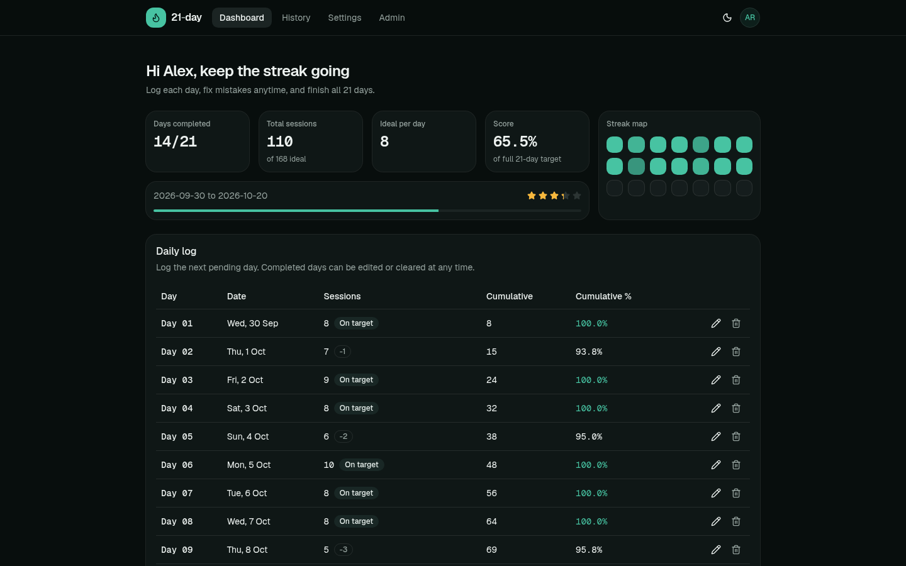

## Website

The fastest way to get a feel for 21-day is its website, **[21-day.sid426.dev](https://21-day.sid426.dev)**:

| Section | What you'll find |
| --- | --- |
| [Features](https://21-day.sid426.dev/#features) | Everything the app does, at a glance |
| [Scoring](https://21-day.sid426.dev/#scoring) | An interactive demo: change the daily ideal and total sessions, and watch the score and fractional stars update |
| [Tour](https://21-day.sid426.dev/#tour) | A walkthrough of the real UI: the daily log, completion screen, PDF report, history, settings, admin panel, and mobile views |
| [Self-host](https://21-day.sid426.dev/#self-host) | The one-line install command, ready to copy |
| [FAQ](https://21-day.sid426.dev/#faq) | Serverless hosting, privacy, missed days, email, HTTPS without deSEC, backups, and who can sign up |

> [!NOTE]
> The website is a static landing page, not a hosted instance of the app. 21-day is self-hosted, so you run your own copy on your own server ([see below](#self-hosting-with-docker-recommended)).

## Features

- **Daily logging.** A 21-row table with cumulative totals and the percentage of your ideal pace so far. Press Enter to log a day and the next day is focused automatically. Fix a wrong entry or clear a completed day at any time. Future days stay locked.
- **Honest scoring.** Your score is total sessions as a share of 21 × your daily ideal. Stars are fractional (0-5): 72.9% earns 3.64 stars, not a rounded 4. At the end, the app congratulates or reprimands you based on how you did.
- **PDF reports.** Every finished challenge produces a clean, printable report. It can be sent to you automatically by **email (SMTP)** and/or **[ntfy](https://ntfy.sh)** push notification, with the PDF attached.
- **History.** Save a finished challenge to history, or download the PDF and discard it. Saved challenges can be viewed read-only, downloaded again, or deleted one at a time or all at once.
- **Multi-user, with real auth.** Sign in with email or username + password, plus optional **TOTP two-factor authentication** and **passkeys**. Powered by [Better Auth](https://better-auth.com).
- **Admin panel.** The first account becomes the single administrator. The admin can close public sign-ups, invite people by email or link, ban/unban users, sign them out everywhere, or delete them. The panel only unlocks for a session verified with 2FA or a passkey.
- **Your data, your server.** Ships as a Docker Compose stack with automatic HTTPS. All data lives in one folder, so a backup is a single `tar` archive. No analytics, no telemetry, no third-party calls unless you configure SMTP or ntfy.
- **Polished UI.** Responsive, keyboard-friendly, with light, dark (default), and system themes. Your theme choice follows your account across devices.
- **Account deletion.** Users can delete their account and all of their data in one step.

## Screenshots

| | |
| --- | --- |
| 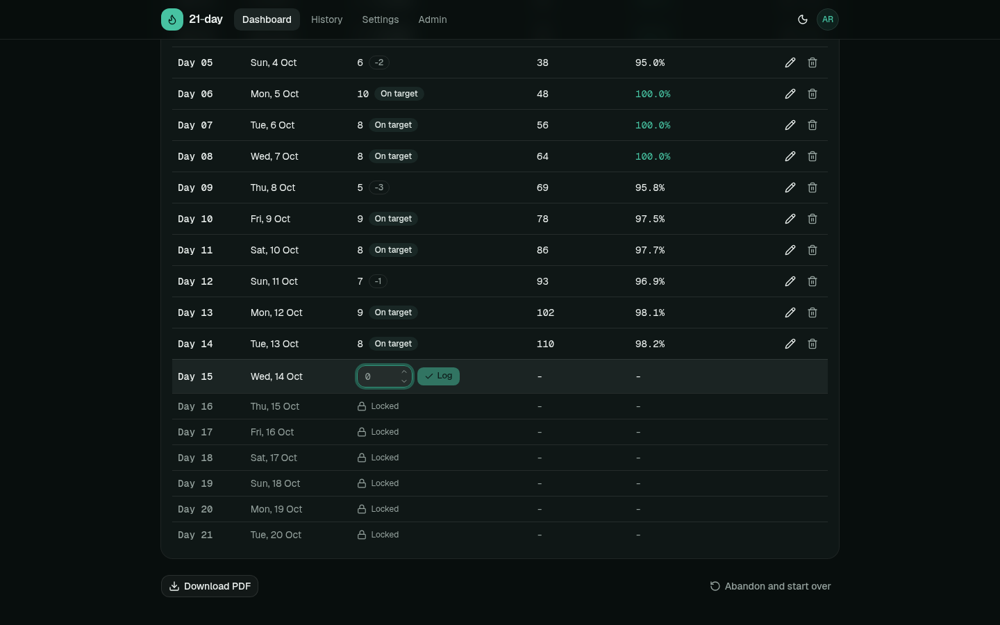 <br> **Log each day.** Edit or clear completed days; future days are locked. | 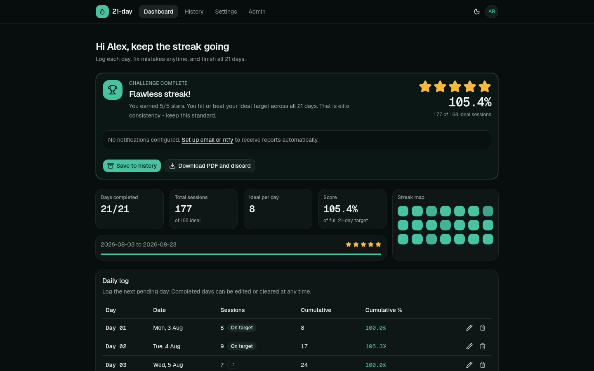 <br> **Finish strong** and get celebrated (or called out when you slack off). |
| 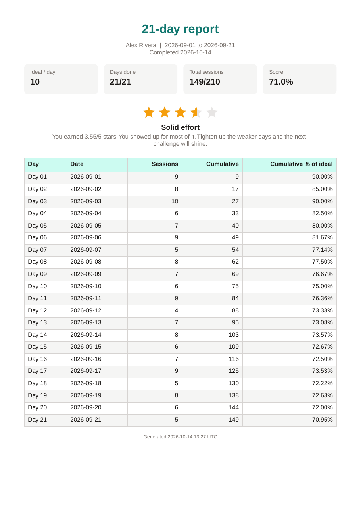 <br> **PDF report** sent by email and/or ntfy. | 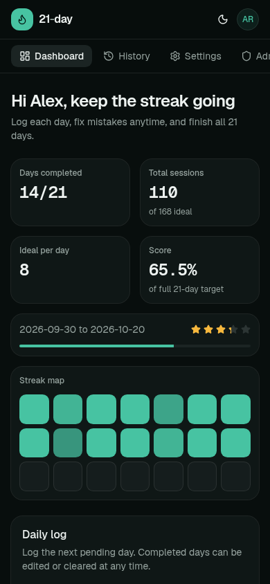 <br> **Mobile** dashboard. |

<details>
<summary><strong>More screenshots</strong></summary>

<br>

| | |
| --- | --- |
| 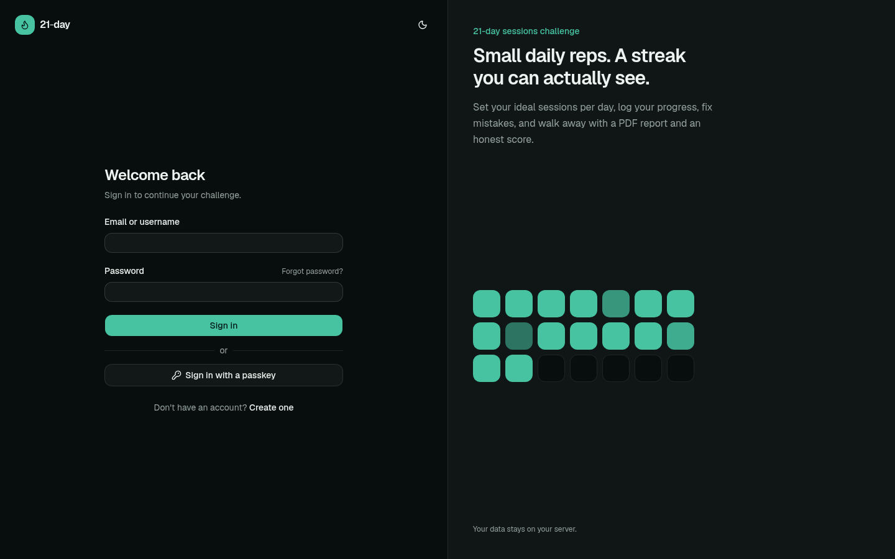 <br> **Sign in** with email or username, password, 2FA, or a passkey. | 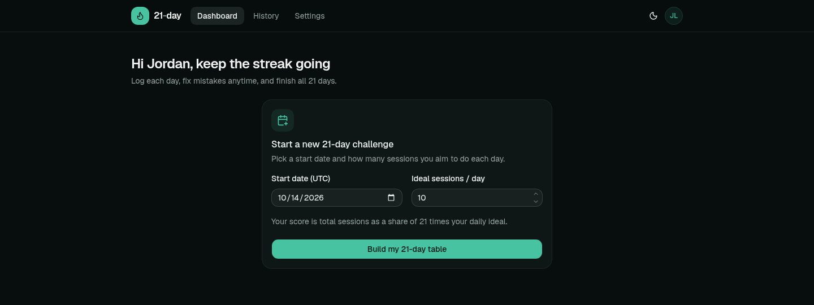 <br> **Start a challenge** by picking a start date and a daily ideal. |
| 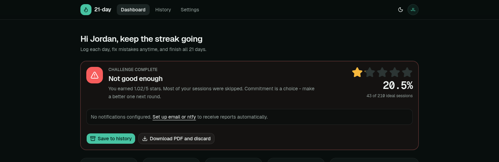 <br> **Reprimand** when the score is low. | 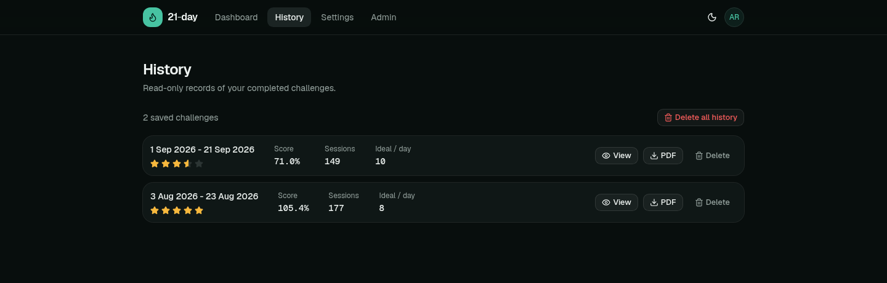 <br> **History** of saved challenges. |
| 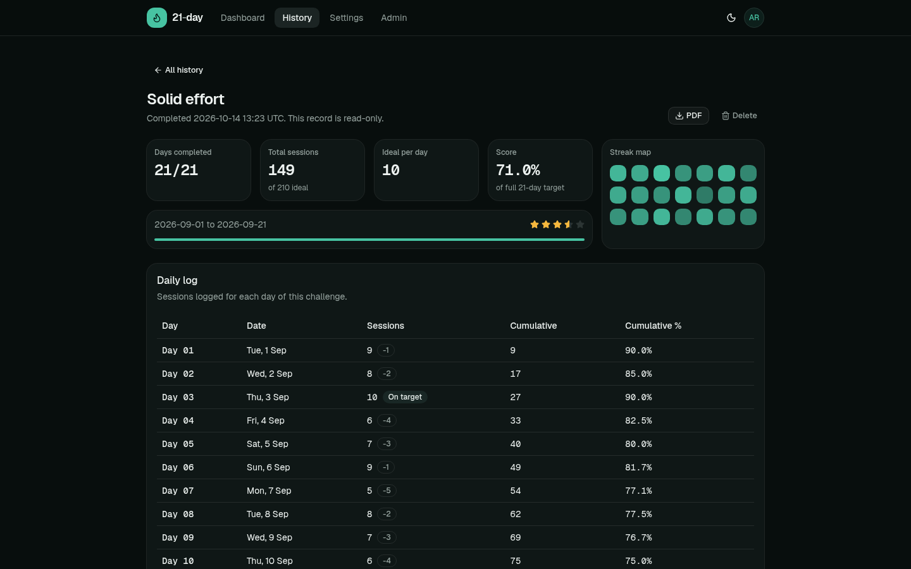 <br> **Read-only detail** of a past challenge. | 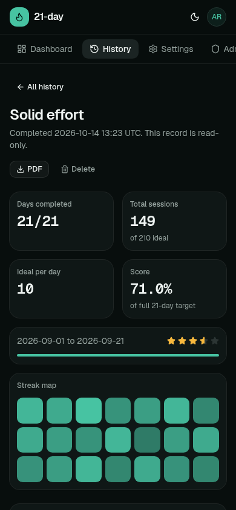 <br> **Mobile** history detail. |
| 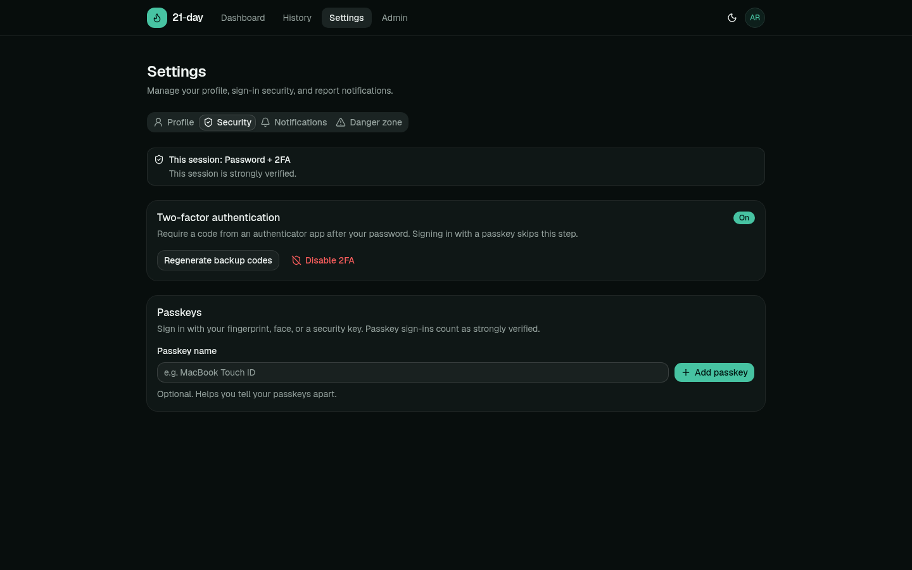 <br> **Security**: TOTP 2FA, backup codes, and passkeys. | 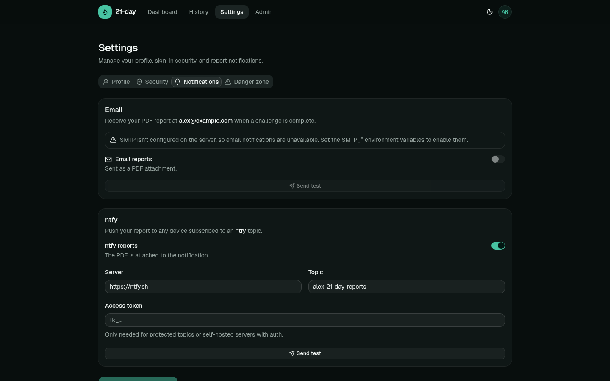 <br> **Notifications**: email and ntfy, with test buttons. |
| 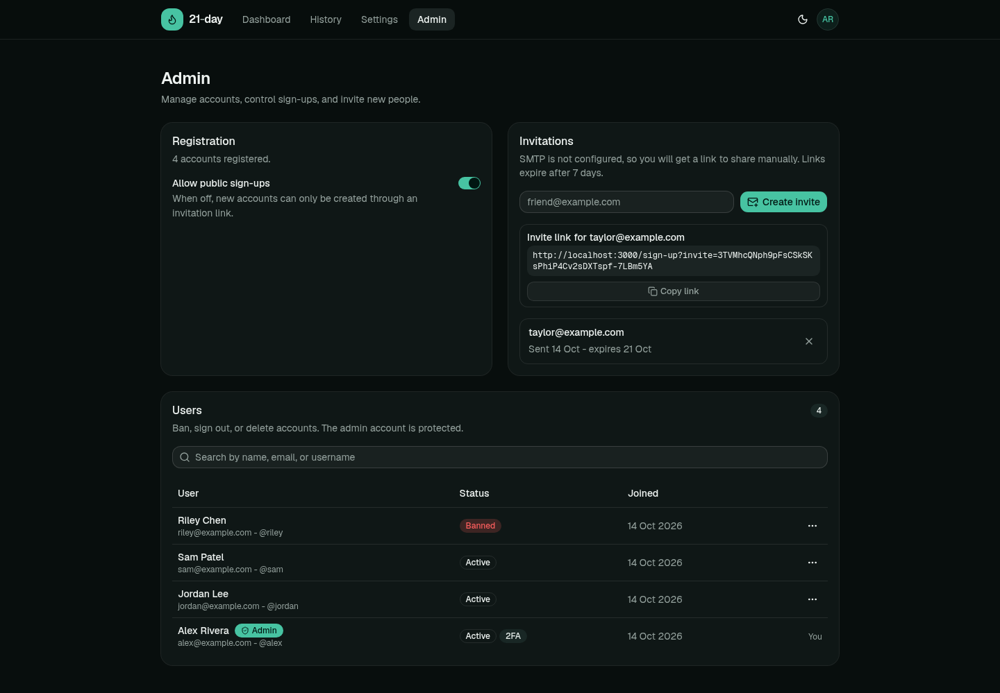 <br> **Admin**: sign-up toggle, invitations, and user management. | 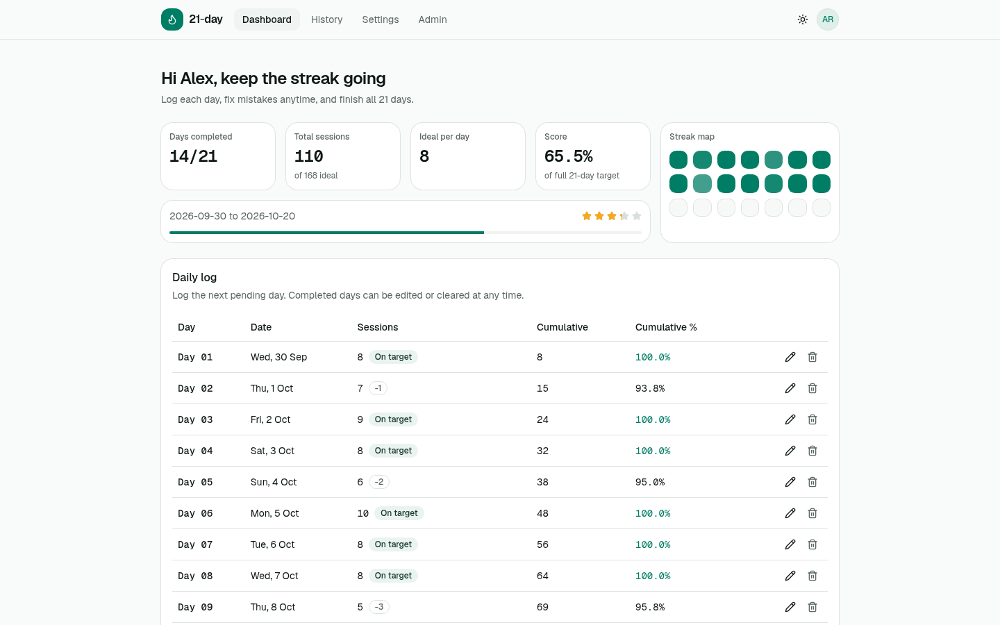 <br> **Light theme** (dark is the default). |
| 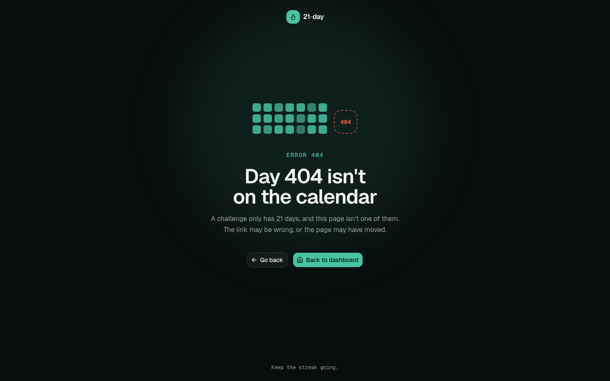 <br> A **404 page** that stays on theme. | |

</details>

## How scoring works

| | |
| --- | --- |
| Ideal total | `idealPerDay × 21` |
| Score | `totalSessions ÷ idealTotal × 100` (can go above 100%) |
| Stars | `min(score, 100) ÷ 20`, rounded to 2 decimals (100% = 5 stars, 10% = 0.5 stars) |
| Verdict | 5 stars: flawless · 4+: celebrate · 3+: encourage · below 3: increasingly blunt reprimands |

Only completed days count toward totals. A day logged with 0 sessions is still a completed day.

## Tech stack

- [Next.js 16](https://nextjs.org) (App Router, route handlers and server actions on the Node.js runtime), React 19, TypeScript
- [Tailwind CSS v4](https://tailwindcss.com) and [shadcn/ui](https://ui.shadcn.com) on [Base UI](https://base-ui.com)
- [Better Auth](https://better-auth.com) with the username, two-factor, passkey, and admin plugins, stored in **SQLite** ([better-sqlite3](https://github.com/WiseLibs/better-sqlite3))
- [Apache CouchDB](https://couchdb.apache.org) for challenge progress, history, and notification settings
- [PDFKit](https://pdfkit.org) for reports, [Nodemailer](https://nodemailer.com) for SMTP, and ntfy over HTTP for push
- [Caddy](https://caddyserver.com) as the HTTPS reverse proxy in the self-hosting stack

## Self-hosting with Docker (recommended)

The stack runs three containers from prebuilt images, so there is nothing to build:

| Service | Image | Role |
| --- | --- | --- |
| `app` | `ghcr.io/sidhartha426/21-day:latest` | The Next.js server (standalone build, runs as the non-root `node` user, uid 1000, with a healthcheck) |
| `couchdb` | `couchdb:3` | Progress data. Only reachable on the internal Compose network. |
| `caddy` | `ghcr.io/sidhartha426/caddy:latest-desec-alpine` | HTTPS reverse proxy with automatic Let's Encrypt certificates, security headers, and compression. A custom Caddy build that includes the [deSEC](https://desec.io) DNS module. |

Images are published for `linux/amd64` and `linux/arm64`.

### Requirements

- Docker with the Compose plugin
- A domain (or subdomain) for the app, from any registrar, with a DNS record pointing at your server
- Any DNS provider. The default Caddyfile uses deSEC; for other providers, see [TLS certificates](#tls-certificates).

### 1. Set up the folder

Run the setup script in the directory where the stack should live:

```bash
curl -fsSL https://get.sid426.dev/21-day-init | bash
```

The short link points to [`docs/hosting/init.sh`](docs/hosting/init.sh) on the `main` branch. To review the script before running it, or if the short link is ever unavailable, use the GitHub URL directly:

```bash
curl -fsSL https://raw.githubusercontent.com/sidhartha426/21-day/main/docs/hosting/init.sh -o init.sh
less init.sh   # review
bash init.sh
```

It shallow-clones this repository, moves [`docs/hosting`](docs/hosting) to `./21-day`, renames `.env.docker.example` to `.env`, creates the `app/data`, `couchdb/data`, `caddy/data`, and `caddy/config` directories (with the right owner for `app/data`), and removes the temporary clone.

<details>
<summary>Prefer to do it by hand?</summary>

```bash
git clone --depth 1 https://github.com/sidhartha426/21-day.git 21-day-source
mv 21-day-source/docs/hosting 21-day && rm -rf 21-day-source
cd 21-day
mv .env.docker.example .env
mkdir -p app/data couchdb/data caddy/data caddy/config
sudo chown 1000:1000 app/data   # the app container writes here as uid 1000
```

</details>

### 2. Fill in `.env`

```bash
cd 21-day
nano .env
```

| Variable | Value |
| --- | --- |
| `BETTER_AUTH_SECRET` | A long random string: `openssl rand -base64 32` |
| `BETTER_AUTH_URL` | The public URL people will open, with no trailing slash, e.g. `https://21-day.example.com` (add `:PORT` if `HTTPS_PORT` isn't 443) |
| `COUCHDB_PASSWORD` | A strong password for the internal CouchDB admin user |
| `APP_DOMAIN` | The domain Caddy serves, e.g. `21-day.example.com` |
| `ACME_EMAIL` | Your email for Let's Encrypt |
| `DESEC_API_KEY` | deSEC API token for the DNS-01 challenge. Only needed if your DNS is hosted at deSEC (the default Caddyfile). |
| `HTTPS_PORT` | Optional. Leave empty for 443. |

Optionally fill in the `SMTP_*` variables to enable email reports, invitations, and password resets. See [Configuration](#configuration) for every option.

### 3. Start the stack

```bash
docker compose up -d
```

Open your `BETTER_AUTH_URL` and **create the first account. It becomes the administrator.** Then go to **Settings → Security** to enable 2FA (or add a passkey), sign out, and sign back in with it to unlock the admin panel. With the default deSEC setup, the first certificate can take a few minutes because Caddy waits for the DNS-01 record to propagate.

> [!WARNING]
> Keep `BETTER_AUTH_SECRET` stable. It signs sessions and encrypts 2FA secrets, so changing it signs everyone out and breaks two-factor sign-in for users who enabled it.

### The `21-day` folder

Everything the stack needs, including all data, lives in this one folder (bind mounts, no named volumes):

```text
21-day/
  .env                        your configuration
  docker-compose.yml
  app/data/                   SQLite auth database (auth.db, -wal, -shm)
  couchdb/data/               CouchDB databases
  couchdb/10-single-node.ini  CouchDB config (keep the 10- prefix)
  caddy/Caddyfile             reverse-proxy config
  caddy/data/, caddy/config/  certificates and Caddy state
```

### Backups

Stop the stack and archive the whole folder:

```bash
cd 21-day
docker compose down
sudo tar -czpf ../21-day-backup-$(date +%F).tar.gz -C .. 21-day
docker compose up -d
```

To restore, extract the archive with `sudo tar -xzpf 21-day-backup-YYYY-MM-DD.tar.gz` (on the same or a new server) and run `docker compose up -d` inside it. `sudo` keeps the file owners the containers expect (uid 1000 for the app, 5984 for CouchDB).

### Updating

```bash
cd 21-day
docker compose pull
docker compose up -d
```

Database tables are created and migrated automatically on startup. To pin a release instead of following `latest`, change the app image tag in `docker-compose.yml`, e.g. `ghcr.io/sidhartha426/21-day:1` (major), `:1.2` (minor), or `:1.2.3` (exact).

### TLS certificates

The default `caddy/Caddyfile` gets certificates from Let's Encrypt with the **DNS-01 challenge through [deSEC](https://desec.io)**, a free DNS hosting provider that works with a domain from any registrar. With DNS-01, ports 80 and 443 don't need to be reachable for validation, so `HTTPS_PORT` can be any port. Set `DESEC_API_KEY` to a deSEC token that can manage your domain.

**Is your DNS hosted somewhere else?** That works too. Pick one:

- **Standard ACME (simplest).** Delete the `import desec_dns` line from the `(common)` snippet in `caddy/Caddyfile` and leave `DESEC_API_KEY` empty. Caddy then uses the TLS-ALPN-01 challenge, which needs `HTTPS_PORT` to be 443 and reachable from the internet.
- **Your provider's DNS-01 plugin.** Replace the Caddy image with a Caddy build that includes your provider's [DNS module](https://caddyserver.com/docs/modules/) and change the `dns desec { ... }` block to match.
- **Your own reverse proxy.** Remove the `caddy` service from `docker-compose.yml`, attach your proxy to the `21_day_network` network, and proxy to `app:3000`.

Whichever you choose, serve the app over HTTPS: passkeys and secure cookies require it.

### Serverless platforms

21-day stores accounts in a local SQLite file, so it **isn't suited to serverless hosts** (Vercel, Netlify, Lambda, ...), where disks are ephemeral and not shared between instances. Use Docker or any long-running Node.js host with a persistent disk.

## Local development

Prerequisites: Node.js 24, [pnpm](https://pnpm.io) (the version is pinned via `packageManager`; `corepack enable` picks it up), and Docker.

```bash
pnpm install --frozen-lockfile
cp .env.dev.example .env    # then set BETTER_AUTH_SECRET
pnpm couch:up               # starts CouchDB (127.0.0.1:5984, admin / changeme) and Mailpit
pnpm dev
```

Open <http://localhost:3000>. With no users yet, `/sign-in` redirects to `/sign-up`, and the first account becomes the admin.

`pnpm couch:up` starts two stock images from [`docker-compose.dev.yml`](docker-compose.dev.yml) (no build step):

| Service | Container | Address | Purpose |
| --- | --- | --- | --- |
| CouchDB (`couchdb:3`) | `21-day-dev-couchdb` | `127.0.0.1:5984` | Progress data. Credentials come from `.env`; data lives in `./couchdb/data` (gitignored). |
| [Mailpit](https://mailpit.axllent.org) (`axllent/mailpit`) | `21-day-dev-mailpit` | SMTP `127.0.0.1:1025`, inbox <http://127.0.0.1:8025> | Catches every email the app sends (reminders, verification, password resets, test emails) so nothing reaches a real inbox. Messages are kept in memory and cleared on restart. |

`.env.dev.example` already points `SMTP_*` at Mailpit, so email works out of the box. To try a real provider instead, set `SMTP_HOST`, `SMTP_PORT`, `SMTP_SECURE`, `SMTP_USER`, and `SMTP_PASS` in `.env`, or leave `SMTP_HOST` empty to turn email off.

| Script | What it does |
| --- | --- |
| `pnpm dev` | Start the dev server (Turbopack) |
| `pnpm build` / `pnpm start` | Production build / serve it |
| `pnpm typecheck` | `tsc --noEmit` |
| `pnpm couch:up` / `pnpm couch:down` | Start / stop the development CouchDB and Mailpit containers |

If `COUCHDB_URL` is unset, progress data falls back to a JSON file at `data/progress.json`. That's handy for a quick look, but not meant for real use.

## Configuration

All configuration is done with environment variables. See [`.env.dev.example`](.env.dev.example) (development) and [`docs/hosting/.env.docker.example`](docs/hosting/.env.docker.example) (Docker).

| Variable | Required | Default | Description |
| --- | --- | --- | --- |
| `BETTER_AUTH_SECRET` | yes | | Secret for signing sessions and encrypting 2FA data |
| `BETTER_AUTH_URL` | yes (production) | `http://localhost:3000` | Public base URL, no trailing slash |
| `PASSKEY_RP_ID` | | hostname of `BETTER_AUTH_URL` | WebAuthn relying-party id. Passkeys are bound to it. |
| `DATABASE_PATH` | | `./data/auth.db` | SQLite file for accounts and sessions (fixed to `/app/data/auth.db` in Docker) |
| `COUCHDB_URL` | | (file fallback) | CouchDB server URL, e.g. `http://localhost:5984` (`http://couchdb:5984` in Docker) |
| `COUCHDB_USER` / `COUCHDB_PASSWORD` | | | CouchDB credentials (the password is required in Docker) |
| `COUCHDB_DB` | | `challenge_tracker` | Database name, created automatically |
| `SMTP_HOST`, `SMTP_PORT`, `SMTP_SECURE` | | `465`, `true` | SMTP server. Any provider works, e.g. Purelymail: `smtp.purelymail.com`, 465 (TLS) or 587 (STARTTLS). |
| `SMTP_USER` / `SMTP_PASS` | | | SMTP credentials |
| `SMTP_FROM` | for email | | Sender address only, e.g. `noreply@example.com` |
| `SMTP_FROM_NAME` | | `21-day` | Sender display name |
| `NTFY_DEFAULT_SERVER` | | `https://ntfy.sh` | Pre-filled ntfy server for users |
| `APP_DOMAIN` | Docker (Caddy) | | Domain Caddy serves and gets a certificate for |
| `ACME_EMAIL` | Docker (Caddy) | | Let's Encrypt account email |
| `DESEC_API_KEY` | Docker (Caddy) | | deSEC API token for the DNS-01 challenge (only with deSEC DNS hosting; see [TLS certificates](#tls-certificates)) |
| `HTTPS_PORT` | | `443` | Port Caddy listens on and publishes (TCP and UDP) |
| `APP_UPSTREAM` | | `app:3000` | Where Caddy proxies requests |

Email features (reports, invitations, password resets) turn on when both `SMTP_HOST` and `SMTP_FROM` are set. Without SMTP, the admin gets a copyable invite link instead, and email reports show as unavailable.

## Notifications

Each user chooses their own channels in **Settings → Notifications**:

- **Email** sends the PDF report to the account's email address (requires server SMTP).
- **ntfy** pushes to any topic on any ntfy server (public `ntfy.sh` or self-hosted), with optional access tokens for protected topics. The PDF is attached.

Reports are sent automatically when the 21st day is logged, and can be resent from the completion screen. Both channels have a **Send test** button.

> [!TIP]
> Topics on public ntfy.sh can be read by anyone who knows the name, so pick a long, hard-to-guess topic or use an access token.

## Security model

- **One administrator.** The first account to sign up becomes the admin. Endpoints that could create a second admin, change roles, impersonate users, or set someone else's password are disabled, and the admin account can't be deleted.
- **Strong admin sessions.** Admin pages and admin API calls require a session that was verified with TOTP 2FA or a passkey. A password-only session is told to secure itself first. Signing in with a passkey skips the 2FA prompt.
- **Controlled registration.** Public sign-ups can be turned off. Invitations are single-use, bound to one email address, expire after 7 days, and are stored only as SHA-256 hashes.
- **Data isolation.** Every progress document is keyed by the owner's user id, and every API route reads the user from the session. Deleting an account removes the user, their sessions, credentials, 2FA, passkeys, and all CouchDB documents.
- **Hardening.** Baseline security headers (`X-Content-Type-Options`, `Referrer-Policy`, `Strict-Transport-Security`, `X-Frame-Options`, `Permissions-Policy`) from both the app and Caddy, input validation with zod on every route, CouchDB never exposed outside the Compose network, and no telemetry.

Found a vulnerability? Please report it privately to the maintainer instead of opening a public issue.

## Data

| Store | Contents | Location in the `21-day` folder |
| --- | --- | --- |
| SQLite | Users, credentials, sessions, 2FA, passkeys, invitations, app settings | `app/data/` |
| CouchDB | Active challenges, history, notification settings | `couchdb/data/` |

Always back up both together (see [Backups](#backups)). The full schema of both databases is documented in [Context.md, section 5.1](Context.md#51-data-stores-and-database-schema).

## Releasing (maintainers)

Pushing a tag like `v-1.2.3` runs [`.github/workflows/docker-image.yml`](.github/workflows/docker-image.yml), which builds the root `Dockerfile` for `linux/amd64` and `linux/arm64` and pushes `ghcr.io/sidhartha426/21-day` with the tags `1.2.3`, `1.2`, `1` and `latest`:

```bash
git tag v-1.2.3
git push origin v-1.2.3
```

An existing tag can be rebuilt from the **Actions** tab (**Run workflow** with the tag name). After the first push, make the package public in the repository's **Packages** settings so self-hosters can pull it without logging in.

### Landing page

The website at [21-day.sid426.dev](https://21-day.sid426.dev) is a separate Vite + React app in [`docs/landing-page`](docs/landing-page), built with Tailwind CSS and shadcn/ui. It's independent of the main app, with its own `package.json` and lockfile, and it imports the README screenshots from `docs/screenshots/` directly, so the two always match.

[`.github/workflows/landing-page.yml`](.github/workflows/landing-page.yml) builds it and deploys it to **GitHub Pages** on every push to `main` that touches `docs/landing-page/`, `docs/screenshots/`, or the workflow itself. It can also be run by hand from the **Actions** tab. The custom domain comes from [`docs/CNAME`](docs/CNAME), and Pages must be set to deploy from **GitHub Actions** (Settings → Pages → Build and deployment → Source).

To work on it locally:

```bash
cd docs/landing-page
pnpm install --frozen-lockfile
pnpm dev
```

## Project structure

```text
app/
  (auth)/          sign-in, sign-up, two-factor, forgot/reset password
  (app)/           dashboard, history, settings (signed-in shell)
  (admin)/admin/   admin panel and its server actions
  api/             route handlers (challenge, history, settings, Better Auth)
components/        UI, grouped by feature (dashboard, history, settings, admin, auth, ui)
lib/
  auth.ts          Better Auth configuration, hooks, and admin hardening
  challenge.ts     pure scoring and table logic (shared by client and server)
  challenge-store.ts  CouchDB document operations
  db/              SQLite connection and the CouchDB/file document store
  pdf.ts, mailer.ts, notify.ts   reports and notifications
docker-compose.dev.yml  dev services for `pnpm couch:up`: CouchDB and Mailpit
docker/couchdb/    CouchDB config bind-mounted by docker-compose.dev.yml
docs/hosting/      self-hosting bundle: docker-compose.yml, .env.docker.example, Caddyfile, CouchDB config, init.sh
docs/landing-page/ the website at 21-day.sid426.dev (Vite + React, deployed to GitHub Pages)
docs/screenshots/  images used in this README and on the website
docs/CNAME         custom domain for the GitHub Pages site
.github/workflows/ image build and push to ghcr.io on version tags, landing page deploy
Dockerfile         production image (Next.js standalone)
Context.md         in-depth architecture and conventions guide
```

## Contributing

Issues and pull requests are welcome. Before you start, read [`Context.md`](Context.md). It covers the architecture, the database schema, the conventions (UTC-only dates, Base UI's `render` prop instead of `asChild`, server-only modules, and more), and testing tips such as fast-forwarding a challenge through the API.

Before opening a pull request:

1. Run `pnpm typecheck`. The production build also type-checks, so it must be clean.
2. Check UI changes in a browser at desktop and mobile widths, in both light and dark themes.
3. Keep dependencies lean: no analytics or telemetry, and no unused packages or components.
4. Update `Context.md` (and this README and its screenshots, if the change is user-visible).
